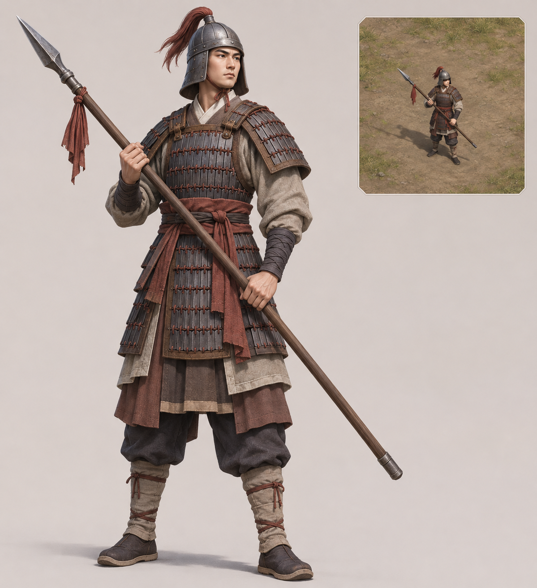
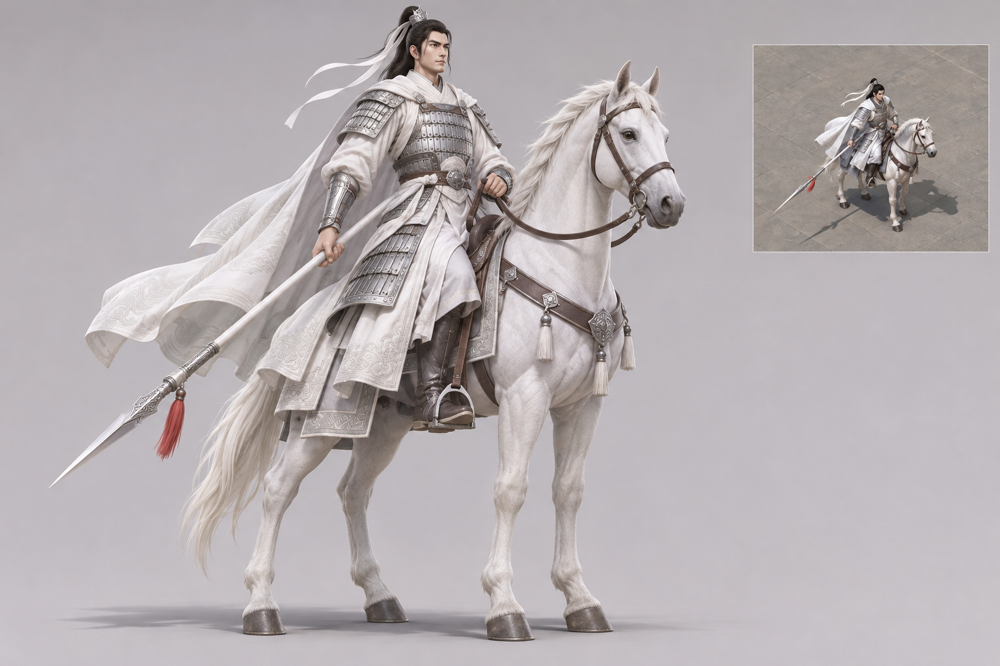
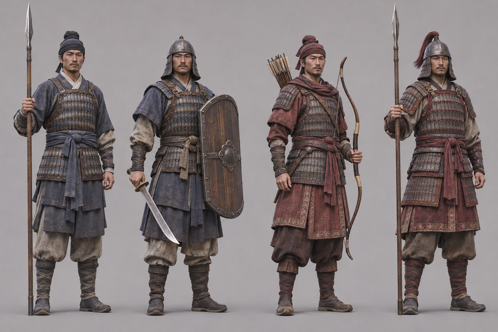

# Owner 最新镜头、人物与整图美术权威 · 2026-11-14

状态：**要求已记录；当前整体美术仍 ART FAIL / OWNER NOT ACCEPTED。**
本文件保存本轮用户明确要求与认可范围，优先于旧文档冲突的固定 size22、全3D、全军同屏或旧模型渐修要求。
它不是实现完成报告，不把概念认可、工程 PASS、源码提交或包可启动当作实机美术通过。
Codex 仍 PAUSED，Dot 自主接续；正式文学剧情留空，重大固定人物/剧情须 Owner 与 Pro 审定。

## 1. 最新视角优先级：以《英雄联盟手游》Wild Rift 为主

用户明确：“以英雄联盟和王者荣耀视角为准，主要以英雄联盟手游视角为准”。
人物与屏幕关系不能太小，也不能太大。应从可信的真实游玩画面研究成熟 MOBA 的角色屏占、
斜俯视构图、朝向/攻击可读性、地形遮挡与信息层级，在本游戏真实运行中对照验证。

- **旧 Field 正交 size22 只作历史回归/前后比较基线，不再是优先于新方向的硬性美术尺度。**
  它也不是相机物理距离22米。新方案须记录投影、size/FOV、俯角、位置、矩阵和实际角色像素包围盒。
- “屏幕内能显示多少就多少”，按真实战争情况和自然人物比例决定屏内可见数量。
  不为了把千军万马或512人都塞进一屏而缩小人物，不要求桥头到城门全部同时入镜。
- **总参战规模与屏幕可见人数分开。** 至少保留20/100/250/512每方的真实战斗验证，
  512每方不是512总数、不是每场固定人数、不是全部必须同时可见，也不是军队规模上限。
  玩家、多名将领及实际屏内军队都须有同等级完成度；屏外战斗、军令、伤亡和世界后果继续真实推进。
- 未经可靠出处，不能把自己推定的正交size、俯角或人物像素数称为 Riot 官方参数。
  合法参考的是视觉设计与公开技术，不复制受保护的商业游戏角色、地图或资源。

## 2. 正常游玩画面的最低质量，不是概念图交差

用户要求画面“非常的清晰、有质感，整个画面非常的自然”，具备现代大型游戏的整体完成度。
参考效果图只是及格线，目标至少达到并超过；主角及普通兵的清晰度、质感须达到下面获认可概念的
**右上角正常游戏视角**，不是仅放大近景。用真实 Godot 画面、动作和性能证明，不预先保证已经实现。

- 手、武器、双手握点、甲片结构、衣甲分区、人体比例、朝向及攻防动作须在正常像素尺寸可读。
- 清晰干净轮廓、稳定抗锯齿、自然体积与材质。不要涂抹感，缩小后不能昏暗、油腻或脏兮兮。
  不以噪点、油亮反光、锐化光边或堆叠装饰替代真正结构与层次。
- 人物、衣甲、武器、马、动作、整张地图、建筑、背景、材质、光影和构图都须全面重建。
  不能把被否定的旧几何当作接近合格的基础逐项小修，不能靠局部滤镜/色彩/照明蒙混通过。
- 优先复用合法、成熟、可编辑且适合公共仓库再分发的完整高品质母版，统一艺术方向并个性化改造。
  合法不等于合格，电影出处/复杂骨架/高面数不等于高质量；不以零件堆砌替代整体美术。
- 先做真实可玩、统一的桥至城门样板，再扩展整张地图和全军，不把样板当最终交付范围。

## 3. 已保存的 Owner 概念来源与精确认可范围

以下三图均是 **Dot 生成并向用户展示的 AI 设计参考，不是实际 Godot 截图**。
按用户授权用于本项目；保留原始 PNG，不伪造外部资产许可，不擅自标成 CC0 或游戏实机。
哈希和尺寸见 [reference-manifest.json](art-direction/owner-20261114/reference-manifest.json)。

### 3.1 普通枪兵：方向已认可

用户认可该单兵方向，并明确要求真正实现在正常战场及全画面相应精细度。
这是造型/材质/正常视角质量方向认可，**不是实际游戏验收，不是正式固定人物/剧情定稿**。
完整人体与手、自然衣物、分层甲片和持枪连接应可读；不用将图中每个微小细节逐像素照搬。
**后续口头修正优先：普通小兵枪不需要红缨。** 图中的枪缨不作为普通兵强制要求；
此修正针对枪上红缨，不擅自扩成所有头盔饰物一律禁止。

### 3.2 白袍白马主角/皮肤：大致认可方向，非终稿

用户提出陈庆之/赵子龙式白袍、白马、白色长枪，可有红缨，作为主角与皮肤设计方向。
对本图反馈“倒也差不多”，重点要求游戏实际效果至少达到右上角正常视角，且大量士兵与多名将领同样达到。
因此状态为 **DIRECTION_ROUGHLY_ACCEPTED / FINAL_IDENTITY_NOT_APPROVED / GAMEPLAY_NOT_ACCEPTED**。
不据此把任何具体历史人物、姓名、背景或固定剧情设成正式主角，不宣称用户已批准终稿或实机。

### 3.3 双方枪盾弓兵差异：当前图片只是候选

用户要求敌军与不同兵种有不同外观，普通枪兵不必有枪红缨。
这张阵营/兵种图 **CANDIDATE_NOT_APPROVED**，不能因枪兵方向获认可而连带宣称整套通过。
继续自主实现清晰可辨、统一风格的枪、盾、弓、将领、骑兵等，不要求用户逐件代做初筛。

## 4. 允许3D、动画贴图、混合，以同场实测决策

不要求每个普通兵都使用全实时3D。高品质共享3D、多方向动画贴图、近中远混合都可采用，
但当前尚未选定最终路线。保留同一完整源、真实动作及材质，在公平画质/内存预算下比较。
不以错误旧模型或未优化178MB单角色求值缓存代表合理共享3D，也不默认贴图必胜。

比较新 MOBA 镜头尺度下的实际清晰度、走停/转向/持枪/举盾/攻击/受击/死亡/骑乘、
长兵器边界、深度/遮挡/阴影、方向切换和大军交战。角色资源共享，不给每个普通兵复制整套模型。
同源码/种子/输入/tick/相机/兵力固定对照；旧size22可附历史回归，不能代替新的艺术尺度验证。
保存2560×1440与3840×2160原图和正常镜头原速录像，记录实际内部渲染尺寸。
若材质TIME/风/水与战斗快照不同步，须记录并固定或披露，不声称完全同时间。

性能用独立无截图读回流程记录硬件、画质、平均FPS、P50/P95/P99、内存和可测显存，
20/100/250/512每方均保持真实攻击、防御、伤亡和屏外战争。不可偷偷降内部像素、
冻结模拟、改成装饰演员、以录屏采样FPS冒充游戏FPS或以理论纹理预算冒充实际显存。
真实 MacBook Air M5 未测则明确 **DEVICE_NOT_RUN**；M1 Virtual/Linux软件渲染不是M5验证。

## 5. 不达标禁止通过、禁止当合格版本放出

用户明确：“一系列要求都是写进GitHub，不要达不到我的要求就放出来，就通过了，持续的设计改进。”

- **全部当前美术仍未通过。** 团队自行对照参考淘汰失败稿，不让用户承担筛选低质试验的工作。
- 未达标代码可在隔离实验分支/内部诊断中保存、测试和恢复，标注 ART_NOT_ACCEPTED；
  不提升成合格RC，不改变默认游戏/引擎或覆盖RC24，不宣传成可用或验收通过版本。
- 不再主动向用户推送失败截图/失败试验包作为成果。保存失败证据、真实状态和下一步，继续独立工作。
  用户明确要求查看当前状态时，只如实展示并说明，不冒称合格。
- 工程、安装包、性能、设备与整体美术验收分开。CI绿色、头部画面、局部变好或包能启动都不能越过艺术门槛。
- 正式美术验收仍必须由用户观看真正游戏后确认。方向认可不是实机批准，未运行/失败/进行中必须区分。
- 每轮实际编码/资产制作、真实运行、自审、回归、可恢复提交、记录下一条命令，然后继续。
  一次PR、报告或等待一项需批准动作不是全部独立工作停止条件。

## 6. 不变的授权与系统边界

保留九类武器与技能、骑马、战车、军令、将领、攻城、真实伤亡、战前部署、战后结算、
行军、世界模拟、经济与旧存档兼容。正式文学剧情继续留空。
已有权限内普通开发/测试/修复/PR/合并/合法资产集成与内部验证由 Dot 自主负责。
不使用Codex、不访问用户电脑、不新增费用或账号、不购买资产、不正式商业发布，
不擅改核心产品目标。许可必须覆盖实际分发方式，公共仓库及公开CI不能泄露受限源素材。
RC24、RC25与所有失败/验证记录保留，设备或资源限制不阻止其他独立工作。
