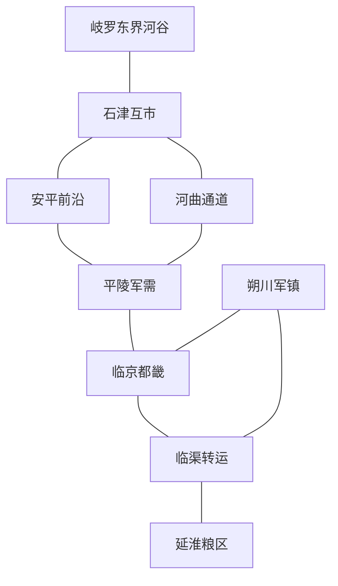

# 《乱世》Pro 剧情提案 v0.4｜晟朝历史、地理与权力结构

> **审阅更新（2026-11-08）：v0.4 的叙事推荐已撤回。**
> Owner 未接受本版的创作呈现，指出人物刻板、缺少灵性、生活气、真实感与人性。本版不再作为推荐剧情或实施依据，原四项审定选择一并撤回。
> 新创作见 [Pro 剧情重写稿 v0.5](PRO_NARRATIVE_STORY_REWRITE_V0_5.md)，仍未获批准。以下保留旧版原文供对照；历史研究和工程核验仅按其各自证据、日期与快照作为资料，不为旧版创作背书。

**状态：PROPOSAL／等待 Owner 审定。** 日期：2026-11-08。本文中的国号、纪年、地名、制度细节和人物均为本轮创作方案；沿用“晟”这一旧稿占位名，不表示此前已经批准。用户已锁定的体验与边界仍以 `PRODUCT_DECISIONS.md` 为准。本文不修改现有工程，也不把新世界数据写入运行中的游戏。

阅读入口：[提案总览与审定项](PRO_NARRATIVE_PROPOSAL_V0_4.md)。历史证据与年代核验另见 [历史研究](PRO_NARRATIVE_HISTORY_RESEARCH_V0_4.md)；以下除明确标记的取材说明外，全部是原创架空设定。

## 1. 推荐的历史命题

**晟朝仍然有资格、也有能力争取中兴；但任何人想把天下重新收回一道军令之下，都必须回答：这些年替朝廷守住土地的人，究竟还拥有什么？**

这不预设中央正确或军镇正当。朔川节帅能保护军户，也能把公家的军队当作家产；皇帝能阻止地方兼并，也能用边民的损失换取收权的窗口；高原统军可以惩治抢掠，也会为取得谈判地位毁掉对岸的粮站。判断落到具体行为和承担后果的人身上。

玩家十五岁入伍时接触的是一支尚有训练、有胜仗、有老兵愿意照顾新人的军队。因此后来发生的失信才有分量。成年后的力量来自实际保存下来的队伍、军粮、信任和行动，而非“见过黑暗便自动获得天下大义”。不公可以被纠正，友情可以持续，秩序可以重建；这些成功不会被作者在片尾撤销。

## 2. 原创纪年与不可回写的前史

采用作者侧“晟历”连续记年，人物侧使用年号。**典型开局为晟历184年，承宁九年，主角约十五岁。** 在本提案的年界简化下，176年为承宁元年；精确生日与月日由世界时钟派生。后续君主更替可能换年号，不重置世界时间。

| 晟历 | 历史阶段 | 发生了什么 | 留到开局的制度后果 |
| --- | --- | --- | --- |
| 1—18 | 开国与统一 | 萧氏从西部盆地起兵，控制通往东部粮区的河运，联合地方大姓结束前朝末年的连年战争；不是凭一支无后勤骑兵扫平全国 | 皇室拥有都畿田赋与授官权；地方豪族保留乡里组织，中央对基层的掌握从来不完整 |
| 36—70 | 承平盛世 | 修复水利、驿路和户籍，常备边军与轮调守备并行；商旅可沿河道穿越多数州郡 | 人口、税源与都城供给增长；“朝廷能让道路安全”成为几代人的真实记忆 |
| 72—110 | 盛世的长期账单 | 西方岐罗整合高原河谷，边地驻防从短期差役变为长期军役；营田不足以同时承担作战、家属口粮与军马饲料 | 朝廷逐渐把募兵、军饷筹措和地方任用交给边镇；名义上的轮换职权变成将领与军户长期依附 |
| 116—123 | 漳原兵乱 | 两支大镇因撤换、欠饷和权力竞争相继举兵；另一些军镇支持朝廷，中央借地方兵平乱 | 都畿受损，西线抽调，岐罗取得数处河谷和冬牧地。战争没有让所有地方自动成为叛镇 |
| 124—135 | 赦授与停战 | 朝廷以确认部分军镇现任统帅、暂留部分税赋换取停战与名义臣属；军镇承诺定额输粮并接受诏命 | “暂行”的税额、军籍和继任默契延续数代；朝廷有撤换的法统，地方握有不服从的能力 |
| 136—151 | 恢复不均 | 东南粮运先恢复，西北许多军户仍借粮过冬；内地商路繁荣与边地空村同时存在 | 税收总额恢复不等于资源能准时到前线；军事强镇不必是最富裕地区 |
| 152 | 计产两征 | 朝廷改按登记资产、土地与实际居住情况核定部分赋额，夏秋两次征解；地方执行并不一致 | 无地军户与迁入户可能受益，隐产大户与中间承征者也能转嫁负担；改革不是按下按钮解决财政 |
| 166 | 石津会约 | 晟与岐罗划定一段争议水道，恢复季节互市，约定放牧、逃户与俘虏交还的处理办法 | 约文对一条改道支流的界限含糊，地方各有解释；两边依靠互市生活的人形成跨境担保网 |
| 176 | 萧承曜即位 | 现帝二十四岁继位，优先整顿都畿粮仓与奉宁军饷路，暂缓普遍削镇 | 何照的军需组织获得皇帝信任，边军将领期待重新获得稳定给养 |
| 180—182 | 可见的恢复 | 河运清淤、清查虚额、分期补发军饷；宥川军乱被中央与地方盟军共同平定 | 朝廷拥有一支真正打过胜仗的机动军，也背上赏功和抚恤欠账。皇帝由此相信收权时机已到 |
| 183—184 | 双线压力形成 | 岐罗东界要求重议石津通路与冬牧权；朔川收到新的税额核验和统军更替安排 | 双方都不是突然变坏。过去的模糊妥协同时到期，中央不能无限同时供养西征与内征 |

上表开局前已经发生的事实属于 A 层。**184年以后没有“某年皇帝必死”“某年都城必陷”的正史轨道。** 漳原兵乱的主要责任者已属于上一代，不让同一批NPC承包七十年的历史。

### 与真实唐史的距离

制度灵感主要取自安史之后的军镇、军费与中枢重建，以及八世纪后期至九世纪初的唐蕃关系。较晚唐末的地方军事自主只是另一组结构参照。计产两征不是对780年两税法的逐条复原，奉宁军不是神策军换名，岐罗也不是把真实吐蕃延长到九世纪末。各自兴起、改革、战败与和议在上述原创时间线上成立。真实年代不得从架空纪年换算推导；依据见历史研究文档。

## 3. 地理必须解释政治

### 3.1 四个区域与两条命脉

| 区域 | 地理、生产与运输 | 政治功能 | 玩家能够接触的生活 |
| --- | --- | --- | --- |
| 西北定西走廊 | 山口连接高原与内地；河谷能耕作，离开水道便难以供应大军。安平在前沿，平陵为后方军需节点，河曲扼通路 | 定西军防御与岐罗东界压力相遇；三城原型可作为候选局部，不等于全国地图 | 杂甲修补、马料与民粮竞争、退伍者租田、互市通事、随军家属 |
| 临京与都畿 | 内陆盆地，靠本地粮食和东来河运共同供给 | 皇帝、官僚、宫廷与中央军聚集；城防军不能全部调离 | 等待军饷的军户、军器作坊、朝集使团、无法迅速归家的边地证人 |
| 北部朔川 | 农牧交界，有马匹与坚实军户组织；运输季节性强 | 半世袭军镇，兵多而稳定可解之税少，必须以军功与保护证明自身正当性 | 军户与佃户不平等、旧兵推立统帅、外姓将校被压制、边防的日常必要性 |
| 东南延淮 | 粮区、渡口与漕渠相连，人口和商业较密 | 以运输能力和供粮信用影响朝廷；节帅名义服从中央，地方货主与仓场实际参与筹粮 | 船工、仓户、债契、受征发的农户；繁荣港市和缺种粮的乡村同时存在 |

两条命脉是“延淮—临渠—临京”的粮运干线与“临京—平陵—安平/河曲—石津”的西部补给网。临渠是干线转运及支路交会地，不是凭名字就能控制全国的万能关卡；其他支路可以分流，但有运力、季节、保护成本。

下图仅表示候选通达和供给关系，不是距离比例图，也不覆盖原型已经实现的路网。

三城的叙事方位是**候选映射**。现有 `anping/pingling/hequ` 等原型标识、路网与数据须由 Dot 保留；若实际地图不适合上述关系，调整新提案的地理，而非改造已验证工程来迁就本文。雪汀渡是一处未来可加的局部战场地形，不冒称当前已有渡运机制。

### 3.2 距离与季节的写作约束

军报行程、部队行程、粮队行程应分别计算。骑使能先到，不意味着粮车也到；高原军在低地过夏与内地军在高原过冬都有实际成本。山口封雪、河水涨落和农忙先作为少数可解释的季节条件，不要求开发全国气候模拟。地图没有连通路线的人不得在关键台词前瞬移出现。

“敌军到来”之前应看到可观察的迹象：驿骑换马、牲畜被低价抛售、盐价波动、边市提前闭市、过境人口增加。迹象可以被误解，不能让一条市场消息自动显示敌方全部秘密计划。

## 4. 晟朝的权力不是一个阵营按钮

### 4.1 法定权力、实际权力与依赖

| 行动者 | 法定/公开权力 | 实际掌握 | 依赖与不能做的事 |
| --- | --- | --- | --- |
| 皇帝萧承曜 | 授官、赦令、征讨名义、中央军调动的最高裁可 | 宫廷任免、直属军饷优先权、跨镇协调信用 | 不能跳过军队行程；命令可能未送达、被曲解或拒绝。不能同时把都城守备调到两条战线 |
| 奉宁军及其将领 | 中央机动军与近畿防务 | 较好的训练、部分精良装备、可追踪的兵员 | 军官有个人威信，兵士在乎饷与家属；名义忠君不意味着无饷仍无限效命 |
| 监军何照及宫廷渠道 | 查验军需、呈报军情、监督诏令 | 接近皇帝的报告通路、部分拨粮与复核权 | 不是全军战术指挥官；不能凭宫籍独占所有物资。误判会损害皇帝和自身位置 |
| 中枢官僚 | 财政核额、官员任免程序、司法复核、外交文书 | 文书、征解、仓场及地方文官网络 | 不是只会阻挠的文臣群体；没有实际运输与地方配合，批文不能变成粮食 |
| 定西行营及裴行简 | 边境防御、临时战场委任 | 熟悉地形的部将、驻地供应网络、作战信用 | 不能独自承诺全国边界；前线用兵自由与地方税权并不相同 |
| 朔川许氏 | 获朝廷承认的节帅职位 | 军户、亲兵、基层军官联盟、地方征收 | 职位不是法律上自动世袭。家族继任可能被军中强人、文官或皇帝拒绝 |
| 延淮军政与粮运各家 | 维持水道、完成定额供粮 | 船只、仓储、劳工组织、垫付粮款能力 | 资产分属多人；一位女儿结婚不能使整个漕运体系变成陪嫁 |

本提案不细抄真实唐代每个官名。关键是四种可分离权利：**谁授职、谁发饷、谁能下令、士兵实际跟谁走。** 玩家可能有诏书却没有粮，有粮却没有合法官职，有军职却只指挥愿意服从的一部分人。

### 4.2 初始军事能力的候选尺度

以下数值只用于检查“谁有能力做什么”的叙事数量级，**不是已验证平衡值，更不是要求 Dot 立即扩大场上人数**。

| 力量 | 账籍/战略总额示意 | 可用于一季远征的约束 |
| --- | --- | --- |
| 奉宁机动军 | 约3.2万人 | 实战可战、需要留守与正在整补者分开；朝廷最可靠的机动力量之一 |
| 都畿守军 | 约1.4万人 | 城门、仓场、宫城、要道均需驻守，不能全部随皇帝一道诏书出征 |
| 中央其他直属驻军 | 约1.2万人 | 分散守备，调集需要时间；不是突然而来的第二支满编奉宁军 |
| 定西军 | 约2.4万人 | 许多分驻堡寨，必须保护军户与粮站；前沿可动员兵力更少 |
| 朔川镇 | 约3.4万人 | 马料、家属粮与乡里守备限制外出兵力；兵籍可能含伤退虚额 |
| 延淮镇 | 约1.2万人 | 护运、治安与守仓优先，财力不直接等于精锐野战军 |
| 岐罗东界军 | 常备与贡役合计约2.8万人 | 东界只占岐罗部分军事力量；临时增援依赖王庭决议、河谷征集和牧草，不是无限生兵 |

全域还有其他非核心州镇。玩家尚未观察的总额不显示为精确实数；这些数字是作者侧初值假设，必须由人口、粮食与军役制度交叉校验。后期十万乃至更大战略总兵力应分散于多地、多军与多个供给体系，不把全国账面总额等同一处战场兵力。

### 4.3 财政冲突的具体链条

宥川胜利需兑现赏功，西线换防需补给，朔川旧定额在中央看来已经过低。在许崇岳看来，朝廷按恢复较快的州县估计全镇税力，又不承认军户多年承担的防务。双方各有部分事实，也各隐去对自己不利的账。

皇帝若先核产、接受分期、保留一定地方防务经费，可得到较稳定收入；代价是短期无法完成全部收权。若要求立即足额解送，延淮可能短期垫付，继而加重粮款与运输压力。过度征发导致耕作和来年税源受损，兵员补充又争夺同一批劳力。发生的是实物与信用的连锁，不是一个“腐败度”把粮仓自动变空。

虚报、勒索、抢掠可以发生，也有确实愿意分期履约的地方官和认真做事的中枢吏员。应让玩家见到一张按约到来的粮单、一场守约的放行、一位确实兑现的上级；否则信用从一开始就无从建立，后续“背信”也失去意义。

## 5. 岐罗：有内政的高原强敌

### 5.1 起源和政治

岐罗在晟历约90—130年间，通过河谷王族之间的婚盟、征服与贡役安排形成王庭主导的联合政权。王庭有直属河谷、精锐与仪式权威；东界统军赤弥有作战权，却需要王庭批准长期增役，并要向支持自己的谷地贵族说明远征所得。

社会包含王庭与贵族家户、受贡役的农牧民、军役户、互市商人、役使人口和若干宗教共同体。河谷农业和高地牧业互相依赖；其宗教生活并不等同后世某种定型的政教结构。各地语言、习俗与权利不完全相同。边地居民可能通婚、双语、负担两边征收，不能按现代民族国家的单一身份理解他们。

赤弥面对的内部争论包括：把战利品分给军役家户，还是交王庭；扩大东进，还是休养河谷；允许商队与晟境维持联系，还是以封市迫使对方谈判。他不能靠自己一句“愿和平”使所有边地停止袭扰，也不能把全部责任推给不受控部下。

### 5.2 军事与社会成本

岐罗拥有适应山地与高原的步骑兵、地方向导与驮运组织，并非全员骑兵。部分精锐装备良好，役兵装备参差。沿河谷作战比深入低地便宜；在晟境久留会遇到粮道、牲畜损耗与地方抵抗。攻城需要准备和物资，不能因为“高原劲旅”标签便穿越城墙。

赤弥可以通过占领渡口、迫使改约、保护附从谷地提高声望；一次昂贵的占城也可能让其所属军役户无法及时回乡。败仗带来伤亡、赎俘、贵族问责；胜仗过多也可能引起王庭猜忌。两边都有希望互市恢复的人，也有从战时劫掠和垄断中获利的人。

### 5.3 为什么184年可能打仗

石津河道数年变迁，使一片冬牧地和盐道税站的归属更加模糊；晟边署在新税核验中收紧通行，岐罗一支地方巡队扣押了税站的驮畜。双方此前已有零星伤亡与未结的索偿。赤弥需要证明旧会约不能被单方解释，裴行简也不能默认前沿驻军每年后退。

开局时动员、闭市与边地武装接触已发生，少年无力抹去。**全面战争仍是各方决策的结果**：及时归还财物、共同勘界、分期互市、成功的有限威慑都可能缩小战事；强硬升级、错误消息或实际攻击也会扩大它。停战能够使这一战区改善，不要求作者为了维持“乱世”立刻刷出另一场同等大战惩罚成功。

## 6. 能成立的五种未来历史

以下是分支的充分因果示例，不是引擎在开局抽选的隐藏结局，也不赋固定百分比。NPC在玩家缺席时同样可以促成这些路径。

| 历史路径 | 必须累积的条件 | 谁获益、谁付出 | 十至三十年后仍存在的矛盾 |
| --- | --- | --- | --- |
| 有限中兴 | 奉宁军主力保存；输粮能够持续；核税有地方参与；至少一个军镇愿意以确认权利换取服从；边境有可执行约束 | 中央重获跨区调兵与较稳定税源；地方失去部分任意征收，普通人可能减少重复征发 | 中央更强也可能更敢冒险；新皇帝未必维持妥协，但不能预写必毁 |
| 武力再集权 | 中央击败主要对手且有能力占领、支付驻军；新官府真实运转 | 结束一部分地方内战，却增加军费和战区治理责任 | 取胜不能自动恢复耕作；军人因功膨胀和长期驻军成本会反过来约束中央 |
| 诸镇共存 | 中央和军镇都不能低成本吞并对方；税约、边防分摊与调停机制形成 | 贸易与地方恢复可能较好；普遍动员较困难 | 继任、灾害和违约会考验约定。不是现代联邦的无代价移植 |
| 中央失势与新整合 | 中央精锐实际损失、粮运中断、命令信誉下降；地方有实际供给和联盟 | 地方统帅或后来者掌握跨区力量；旧朝保留的名义可能被借用 | 新统治者也必须处理原军镇和自己的功臣；玩家可以是整合者，也可只是其臣属 |
| 边境再分配 | 岐罗取得持续补给与附从支持，或晟守住关键通道并履行互市；两边内部政治随战果改变 | 边线、税站、贡役和归属发生变化，某些地区双重关系长期存在 | 高原王庭也可能整合或分裂；不能按真实842年的日期强制复制解体 |

还有一种常见但不是宏观“第六结局”的人生：国家局势只有限改善，主角守住一段粮道、让一批军户归籍、与旧友活到年老。游戏应承认这种成果，不能因未统一而在终章写“终究一事无成”。

## 7. 世界独立运转的具体约定

1. 萧承曜的收权行动来自财政、宥川胜利和朝臣方案，不以玩家获得某级军职为启动开关。
2. 赤弥的巡边、增役、撤围与谈判按自己收到的消息推进；主角不认识岑望，他也能派其他使者。
3. 许崇岳会考虑家族、外姓将领和军户接受度；只有他确实失能、辞职、死亡或被解除权力时才出现接班，不为主角进入内陆自动杀死他。
4. 沈蘅、梁令仪和罗定的迁徙、婚约、任职与亲友责任都有真实生效时间。玩家打开对话前，事实可能已经改变。
5. 玩家若早死，世界在设定上仍有后续，**游戏无需为了证明这一点在死后推进并向玩家展示秘密历史**。只停止本局操作与其视角。
6. 世界不必在每年制造一次全国大乱。前线也能有数年相对安定，供人物结婚、养伤、育儿和经营；战争压力体现为有限资源与远方变化，不等于持续强制惨剧。

## 8. 制作中的历史风险

- **把财政写成伪装的善恶条。** 不采用；同时保留确实腐败、确实困难、合理防务和策略性拒绝四类原因，并允许查明部分事实。
- **藩镇人人都要称帝。** 不采用；许氏首先追求地方安全与家权，中央任命和名义服从也有实际价值。
- **高原政权只有可敬敌将，没有普通人。** 以军役户归期、互市家户与谷地贡粮写其社会成本；不把异域审美本身当作人物深度。
- **为百万军队编造无限人口。** 分开账籍、可战、可动员、实际到场及后勤人口；任何扩张须有对应税区和粮道。
- **把所有历史阶段挤在主角青年十年。** 开局前史已经承担制度形成；游戏内让改革、代际更替与伤病积累消耗真实年月。完整年龄锚与事件节奏见人生结构文档。

**审定边界：** 推荐采用这个世界因果作为主方案；具体国号和纪年可统一替换，不影响已锁定的玩法与公平性。批准本文也不代表批准某场战败、某人必死或某次朝代更替。
