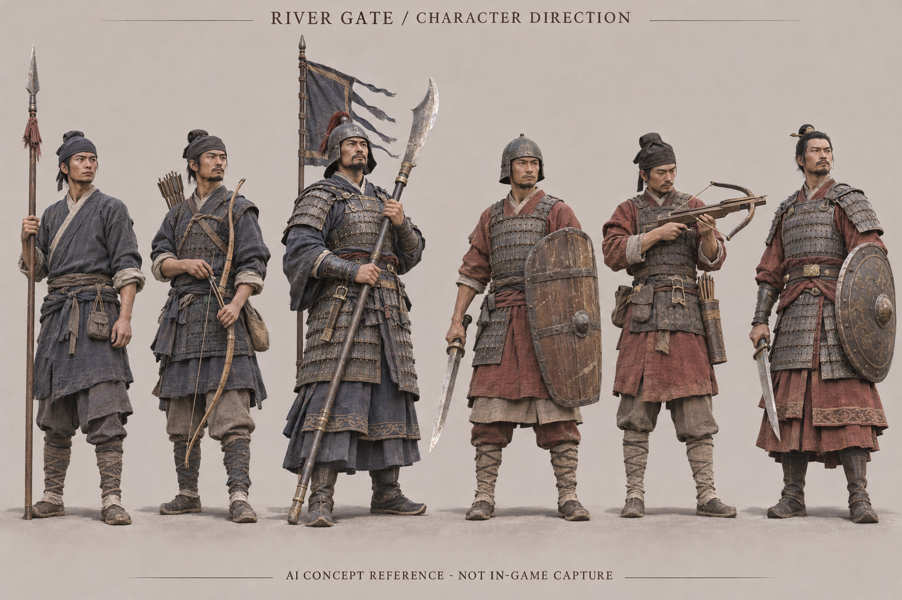

# 河关视觉开发参考

这些图片是本项目本次生成的 **AI 概念参考**，不是历史复原结论、已经完成的模型渲染或游戏截图。角色模型、Blender 实渲和 Godot 独立预览另存于上层目录。

## 01 · 双方角色方向

左为西侧进攻军，右为河关守军。重点参考自然人体比例、布/皮/铁分材质、普通士兵与将领的装备层级，以及靛蓝/赭红的阵营识别。生成图中的具体盔甲纹样、兵刃轮廓与弩结构不作为考古依据；最终装备和武器索引以 `../ENGINE_CONTRACT.md` 及当前游戏为准。

生成日期：2026-11-13（北京时间）。使用内置图像生成工具；未挪用第三方游戏截图或未授权美术。

完整提示词与图片 SHA-256 记录于 `prompts.json`。不把生成图片中的任何新名称、人物或服饰细节变为正式剧情设定。
