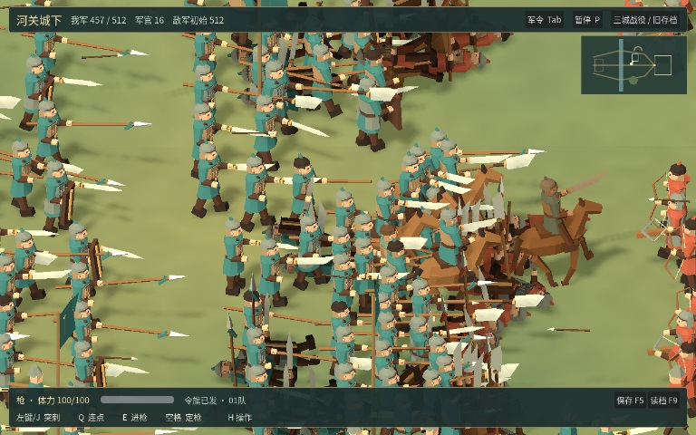
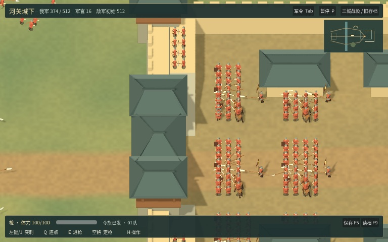
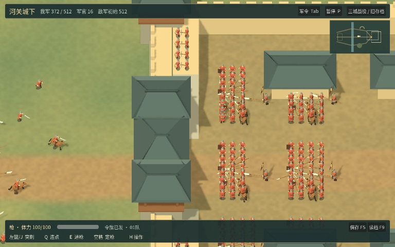
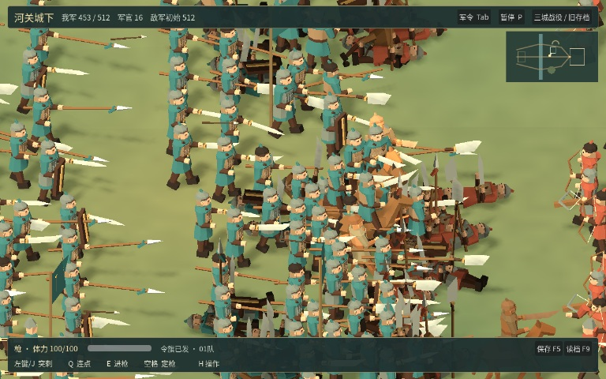
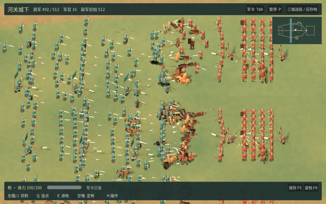

# 河关城下 · 试玩与云端验收

## 当前试玩版

默认进入这张千人战场。解开下载的外层压缩包，在 macOS 上再解压 Luanshi-macOS.zip 并打开其中的 app。选择兵器与军令，按 Enter 开战。GitHub Actions 上的 macOS 和 Linux 两个作业均已成功。游戏提交为 [b6fa81886278](https://github.com/haohongfei2001-png/luanshi-game/commit/b6fa8188627807f65e2238c066dce49e7e3bf5a0)，CI 合并检出为 `c258365fc3523b1510f68b4ba7f83ccd342b14bf`。

[下载 macOS](https://github.com/haohongfei2001-png/luanshi-game/actions/runs/43099735539/artifacts/13890089339) · [下载 Linux](https://github.com/haohongfei2001-png/luanshi-game/actions/runs/43099735539/artifacts/13890638998) · [本版三段 MP4 录像](https://github.com/haohongfei2001-png/luanshi-game/actions/runs/43099735539/artifacts/13892361178) · [运行记录](https://github.com/haohongfei2001-png/luanshi-game/actions/runs/43099735539) · [试玩操作](https://github.com/haohongfei2001-png/luanshi-game/blob/b6fa8188627807f65e2238c066dce49e7e3bf5a0/docs/PLAYING_ZH.md)。

同一随机种子 61112 的正常出阵由双方各 512 名普通士兵、32 名军官与主角组成。城门在 32.40 模拟秒攻破，39.05 秒时守军失去战斗能力。攻守双方剩余 300 / 167 名普通士兵生还，分别有 9 / 25 人离开战场。射出 2,193 支箭矢，双方共 2,158 次命中，军籍与弹药完成结算。全程录像为 392 帧、39.2 秒。

原先困在城墙边沿的弓手现在沿坡退下，经画面中双方都能通行的小后门撤离。Godot 回归覆盖南北城头以及正门完好、已破的组合，四种条件分别在 386 次士兵更新后走过真实的后门，均计入生还撤离。另测了城外守军以及城内攻方向己方出口绕行。[问题与修复](https://github.com/haohongfei2001-png/luanshi-game/pull/23) · [本版机器可读结果](retreat-fix/measurements.json)。





| 环境 | 实际结果 |
| --- | --- |
| Ubuntu 24.04、llvmpipe、1280×800、100% 渲染、动态阴影 | 每方 20 / 100 / 250 / 512 名普通士兵时分别为 29.92 / 22.17 / 18.06 / 11.88 FPS。千人样本 P95 为 93.64 毫秒。相同视角可见 495 名普通士兵，保留近景细节后的绘制中位数为 68.74 毫秒，全员高细节为 191.21 毫秒。 |
| 托管 Apple M1 (Virtual)、默认 Metal、1000×600、100% 渲染、动态阴影 | 两个约 3.5 秒的短样本平均 148.09 / 178.67 FPS，P95 为 16.32 / 14.55 毫秒，P99 为 20.21 / 16.93 毫秒。两次各观察到 416 次命中。 |
| 真实无风扇 MacBook Air M5 | 内屏与外接 4K 的持续 20 分钟 512v512 实测均为 NOT_RUN。 |

可下载[本版 Linux 截图与逐帧数据](https://github.com/haohongfei2001-png/luanshi-game/actions/runs/43099735539/artifacts/13892236163)以及[托管 Mac 原生日志与截图](https://github.com/haohongfei2001-png/luanshi-game/actions/runs/43099735539/artifacts/13892426410)。当前近景采用原创低多边形角色，最终造型、长时手感和河关后期武艺成长仍待完善。双方高阶将领救援和继任由 [#19](https://github.com/haohongfei2001-png/luanshi-game/issues/19) 跟踪。

内部试玩包 SHA-256 如下。

| 文件 | SHA-256 |
| --- | --- |
| `Luanshi-macOS.zip` | `6d11bba21f12f32c8e967a19c5e2d4e4a7219eddbf57761f94685d78ba20374e` |
| `Luanshi-linux.tar.gz` | `7261fcd8a75d9fdebd193c3901f70a9d74887f221af58cca092c8edd94ee5012` |

## 前一版 eae4f9d 的录像与长测

以下三段可直接播放的仓库录像和 196 秒连续接战记录来自 eae4f9d。这份记录保留了预备队长测的逐帧数据，并可与本版比较守军的实际撤离效果。
游戏源码 [eae4f9d3f23f](https://github.com/haohongfei2001-png/luanshi-game/commit/eae4f9d3f23f119fdd210390a9c7f7c7533eae6d)，GitHub 测试与打包检出 ce568994faef7c00742b3e1d7714739b9edbf24c。Godot 4.6.3，固定战场种子 61112。验收包通过托管 Linux 和 macOS 运行。真实 MacBook Air M5 20 分钟持续 60 FPS 的状态为 **NOT_RUN**。

[下载 macOS 包](https://github.com/haohongfei2001-png/luanshi-game/actions/runs/43090225102/artifacts/13889540567) · [下载 Linux 包](https://github.com/haohongfei2001-png/luanshi-game/actions/runs/43090225102/artifacts/13888159714) · [三段实机渲染录像](https://github.com/haohongfei2001-png/luanshi-game/actions/runs/43090225102/artifacts/13889390882) · [Linux 截图、日志与逐帧数据](https://github.com/haohongfei2001-png/luanshi-game/actions/runs/43090225102/artifacts/13889560582) · [托管 Mac 的窗口截图、日志与逐帧数据](https://github.com/haohongfei2001-png/luanshi-game/actions/runs/43090225102/artifacts/13889710826)。

仓库中可直接观看三段无声录像。[完整攻城 · 46.8 秒](siege.mp4) · [九种兵器 · 25.2 秒](weapons.mp4) · [战阵与城防 · 12 秒](formations.mp4)。这些 H.264 副本保留了原片的每一帧，归档分辨率为 512×320。原分辨率录像在上方的 Actions 产物中。[转码与帧数核对](https://github.com/haohongfei2001-png/luanshi-game/actions/runs/43091909052)。

## 正常部署的千人攻城

双方各 512 名普通士兵，32 名军官和 1 名主角另计。两队护送冲车、两队包抄，其余推进。每名士兵始终保有自己的编号和存亡状态。破门、伤亡和军需结算由游戏逻辑产生。

| 事件 | 结果 |
| --- | --- |
| 开始破坏城门 | 27.55 模拟秒 |
| 城门攻破 | 33.85 模拟秒 |
| 战役结束 | 46.70 模拟秒，守军已失去战斗能力 |
| 普通士兵阵亡 / 生还 | 攻方 266 / 246，守方 369 / 143 |
| 弹药与结算 | 射出 2475 支箭或弩矢，双方共 2331 次命中，军籍和库存按编号完成一次结算 |

录像采样按画面帧观察城门变化。20 Hz 模拟记录的破门为 33.85 秒，10 FPS 录像第一次拍到打开的城门为 33.90 秒。

完整攻城录像用游戏默认兵力，从部署一直拍到结果出现。单独的视角录像展示近、中、远景和城墙。九种兵器的录像使用同一张地图上的受控距离，有一名真实敌兵，鼠标普攻造成伤害后再通过 Q 触发技能。固定帧步长只用于这些无声录像。






三种正常部署另外以相同的战斗、地形、存档与 WorldSim 代码进行对照，每次重新从 512 对 512 的原始军籍出发。军令、骑乘和主角动作使用公开游戏接口。该对照使用云端无界面模拟。[部署日志与测试源码](https://github.com/haohongfei2001-png/luanshi-game/actions/runs/43089432898)。

| 军令 | 结果 | 冲车击门 | 生还普通士兵（攻 / 守） |
| --- | --- | ---: | --- |
| 集中护送 | 主将阵亡 | 3 | 314 / 167 |
| 外侧部队待命 | 主将阵亡 | 2 | 324 / 211 |
| 有后卫的撤离 | 成功撤离 | 0 | 508 / 511 |

## Linux 图形性能

Ubuntu 24.04，X11/Xvfb，Mesa llvmpipe 软件渲染，GL Compatibility。输出 1280×800，100% 内部分辨率，动态阴影。每档先等到真实命中再取墙钟帧时间，中途平移镜头。

| 每方普通士兵 | FPS | P95 / P99 毫秒 | 帧数 / 秒 | 采样命中 | 模拟毫秒 / 步 | 软件渲染 GPU P95 毫秒 |
| ---: | ---: | ---: | ---: | ---: | ---: | ---: |
| 20 | 28.00 | 37.81 / 38.00 | 79 / 2.82 | 53 | 0.43 | 33.85 |
| 100 | 20.89 | 50.14 / 53.14 | 59 / 2.82 | 215 | 1.84 | 44.28 |
| 250 | 16.99 | 63.53 / 65.89 | 48 / 2.83 | 328 | 5.08 | 51.44 |
| 512 | 11.11 | 97.63 / 97.85 | 32 / 2.88 | 398 | 11.83 | 68.63 |

每方 512 人的短样本中，20 Hz 模拟每步平均耗时 11.83 毫秒，场景呈现脚本每帧 2.15 毫秒。引擎报告的绘制 CPU / llvmpipe GPU P95 分别为 43.13 / 68.63 毫秒。这些阶段可能重叠，不能直接相加。空间分区与分批决策保住了完整军籍，远景降低网格细节和阴影提交的配对结果如下。

同一批 512 对 512 单位、同一个模拟步和视角，对照保留原近景细节与全员高细节两条绘制路径。10 对姿态的绘制中位数分别为 72.55 和 196.88 毫秒。末帧显示 495 名普通士兵，提交图元数分别为 260461 和 1099332。这组配对值只衡量绘制耗时。



## 同一场战斗的预备队长测

另开一次合法部署，从同一张地图、同一个种子和双方初始军籍各 512 人开始。测试没有重开、读档、暂停、复活或修改生命值。先在无界面比较三种可以在部署面板排出的军令，按发生真实命中的五秒区间数选择图形复验方案，区间数相同则取命中间隔不超过五秒的最长交战时长。三个候选都保留在下表。

| 初始军令与轮换 | 模拟秒 | 有命中的五秒区间 | 最长连续交战（允许五秒间隔） | 结局 |
| --- | ---: | ---: | ---: | --- |
| 中央梯次推进 | 190.3 | 39 / 39 | 189.6 秒 | 守军已失去战斗能力 |
| 两翼交替 | 196.0 | 40 / 40 | 195.3 秒 | 守军已失去战斗能力 |
| 逐队接替 | 200.0 | 40 / 40 | 145.4 秒 | 到了观察截止时仍在战斗 |

实际窗口采用「两翼交替」，将 2 队先投入，其他待命，然后每 14 秒按固定队序用号角传达新任务，超出范围则派传令兵。主角向后走 2.5 秒，随后留在原地指挥。窗口保持游戏正常时间推进，观察点轮流查看两翼、外野和城门。

单局记录 196.0 模拟秒，实际用时 198.73 秒，2210 个呈现帧，累计 2305 次命中。40 / 40 个五秒区间有新增命中，最长无命中间隔 3.70 模拟秒。末次采样普通士兵生还 253 / 143（攻 / 守），此时结局为「守军已失去战斗能力」，世界军籍及弹药审计通过。

| 实际窗口 1000×600，100% 渲染，动态阴影 | 帧数 | 墙钟秒 | 平均 FPS | P50 / P95 / P99 毫秒 |
| --- | ---: | ---: | ---: | --- |
| 整段图形记录（含机动和战斗间隙） | 2210 | 198.73 | 11.12 | 84.34 / 133.92 / 147.22 |
| 距离最近一次新增命中不超过两个模拟秒的帧 | 2176 | 194.20 | 11.20 | 84.54 / 132.68 / 147.01 |

窗口运行在 AMD EPYC 9V74 80-Core Processor，llvmpipe (LLVM 20.1.2, 256 bits)，gl_compatibility。图形命中时间取帧呈现时最近的模拟步。表内最近接战帧来自同一局的若干区间，精确覆盖和间隙可从逐帧数据辨认。普通士兵随伤亡减少。环境、分辨率、伤亡和视角会影响帧率。

复现命令以及直接调用的全部玩家军令已按提交归档。[GitHub Actions](https://github.com/haohongfei2001-png/luanshi-game/actions/runs/43094439832) · [军令与驱动程序](https://github.com/haohongfei2001-png/luanshi-game/blob/eca0f508e0d2a2bba340dc9c480bcb952553bb94/tests/field_endurance.gd) · [完整逐帧 CSV（gzip）](endurance-frames.csv.gz) · [部署和开窗原始结果](endurance-measurements.json)。

在同一台 Ubuntu 24.04 主机依次执行以下命令。第一条保留三种军令的全部结果，第二条读取选择并运行同一场景的真实窗口。

```sh
godot --headless --path . --script tests/field_endurance.gd
LIBGL_ALWAYS_SOFTWARE=1 xvfb-run -a -s '-screen 0 1024x768x24' godot --path . --resolution 1000x600 --disable-vsync --audio-driver Dummy --script tests/field_endurance.gd -- --field-size=512
```

原始作业的部署对照和窗口步骤通过，附件上传失败，工作流最终状态为 cancelled。已直接从该作业日志恢复 2,210 行原始帧数据，交叉检查 gzip 的 SHA-256、CRC、行数、模拟步顺序和最终命中。压缩文件 SHA-256 为 `6b5ff7404b8412d0a77d61bcff29eb1ead76dc1bfef59c3b0a852dbd7e4619b1`。首版长测脚本的类型错误也保存在[首次检查记录](https://github.com/haohongfei2001-png/luanshi-game/actions/runs/43093940143)。

## 托管 macOS 原生窗口

同一份包、同一台托管机交替运行两种后端。Metal 两次均从导出程序默认入口启动，兼容路径使用显式引擎参数，实测时关闭垂直同步。导出程序还通过了原生无界面启动、两类历史存档跨进程恢复、河关激战中存档回放一致性。

| 试次 | 渲染器 | 实际窗口 | FPS | P95 / P99 毫秒 | 帧数 / 秒 | 命中 | 峰值 RSS MiB |
| --- | --- | --- | ---: | ---: | ---: | ---: | ---: |
| compat-1 | gl_compatibility | 1000×600 | 56.11 | 33.27 / 42.84 | 198 / 3.53 | 405 | 315.3 |
| default-metal-1 | mobile | 1000×600 | 94.15 | 28.77 / 33.66 | 330 / 3.50 | 405 | 369.2 |
| default-metal-2 | mobile | 1000×600 | 75.38 | 34.44 / 41.08 | 270 / 3.58 | 405 | 323.4 |
| compat-2 | gl_compatibility | 1000×600 | 38.00 | 48.91 / 55.53 | 134 / 3.53 | 405 | 300.6 |

处理器和图形适配器由程序报告为 Apple M1 (Virtual) 和 ANGLE (Apple, ANGLE Metal Renderer: Apple Paravirtual device, Version 26.7.2 (Build 25G332))。RSS 取自主机计数器。虚拟 GPU 的绘制时间可能跨越许多墙钟帧，报告以墙钟时间比较平台。四档 Linux 与 Mac 短样本均不能代表无风扇实机长时性能。

## 试玩包校验

GitHub 给这次 Actions 产物标注的到期日为 2027-02-09（UTC）。外层下载包解压后，两个内部导出文件的 SHA-256 如下。

| 文件 | SHA-256 |
| --- | --- |
| `Luanshi-macOS.zip` | `4693bab74f6642e858e6176f62d1dfc3e41cba912587c6550dbc6679c89401f4` |
| `Luanshi-linux.tar.gz` | `bf10b1874a0ec316921804cbc4eff5abe2ebc2c913f139fd61ef70fda2a7b036` |

## 复现与剩余验收

在云端 Ubuntu 24.04 安装 Godot 4.6.3 及同版本 macOS / Linux 导出模板，并提供 Xvfb、Mesa 和 ffmpeg。执行以下仓库入口。

```sh
./tools/test.sh
./tools/test-field-render.sh
./tools/test-youth-ui.sh
./tools/calibrate-combat.sh
./tools/export.sh
```

源代码的首次运行需要执行 `./tools/prepare-font.sh`，试玩包自带字体。Mac 原生检查从输出的 app 启动，用 `--headless --fixed-fps 60 -- --field-check` 复核 512 对 512 和中途恢复。实际窗口用 `--resolution 1000x600 --disable-vsync -- --field-check --field-profile --field-proof=<PNG文件绝对路径>`，兼容对照在这些引擎参数前加 `--rendering-method gl_compatibility`。录像、存档入口和完整命令见[工作流](https://github.com/haohongfei2001-png/luanshi-game/actions/runs/43090225102)与[试玩操作](https://github.com/haohongfei2001-png/luanshi-game/blob/eae4f9d3f23f119fdd210390a9c7f7c7533eae6d/docs/PLAYING_ZH.md)。

坡地瞄准的上一个候选在枪、弓、弩的真实鼠标路径上失败。当前候选九种武器的鼠标命中与 Q 键均通过，下列数据保留了每次武器比对结果、坡面点击误差和实际渲染样本。[原失败记录](https://github.com/haohongfei2001-png/luanshi-game/actions/runs/43086157942) · [机器可读记录](measurements.json)。

全军推进的样本约 47 秒决出胜负，分批投入预备队的实测约 196 秒。20 分钟同场持续交战节奏、M5 内屏与外接 4K 表现、最终角色美术与玩家主观手感仍待验收。早期与成熟主角对不同人数的既有校准继续随三城回归运行，河关长期武艺成长仍需专门的玩法及平衡验证。

eae4f9d 中城头弓手可能卡在墙沿。本文顶部的 b6fa818 已通过沿坡退下、经过后门和两翼撤离的回归。[修复及其独立验收状态](https://github.com/haohongfei2001-png/luanshi-game/pull/23)。
