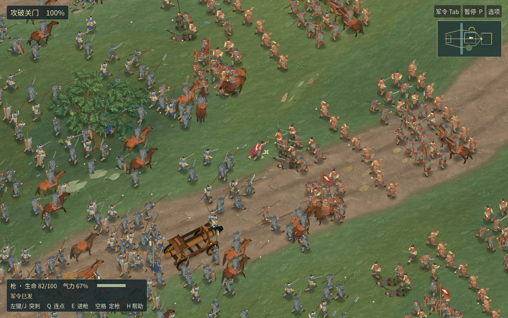

# 河关 0.16.0-rc.10 · 正常镜头实机与候选包

[下载 macOS 图形实测包](https://github.com/haohongfei2001-png/luanshi-game/actions/runs/43395721594/artifacts/14022493652) · [观看军议到战后驻营的 59.2 秒实录](playthrough-review.mp4) · [全尺寸画面](normal-native.jpg) · [原始测量](measurements.json)

下载 Actions 附件、解开其中的 `Luanshi-macOS.zip`，打开应用。内层 ZIP 的 SHA-256 为 `2dc1200783ee40792fa47b0d2632c90a59ebcaa69950297de9bf7e165663995c`。Linux 包与运行日志也已保存。[Linux 包](https://github.com/haohongfei2001-png/luanshi-game/actions/runs/43395721594/artifacts/14022663050) · [完整 CI](https://github.com/haohongfei2001-png/luanshi-game/actions/runs/43395721594)



## 动作与装备

新枪兵压下持枪一侧的肩、以前脚踏住。盾兵分别有等待、承下左侧或右侧来击、卸力回位的动作。九种武器共 36 段左右格挡与受创反应，按实际来击方向选择。接触测试中承重脚位移为 0，另一脚至少移动 0.126 米，持械手腕最大偏差 0.155 毫米。全套动作、数据与伤亡依旧来自同一场 512 对 512 的战斗，另有双方各 16 名军官。

- 102 号兵在第 43 步被 612 号兵击中，生命从 62 降到 44.48。70 号盾兵在第 79 步接下 576 号的进攻，个人有效格挡数从 6 变成 7，生命由 26.54 降到 23.76。对照图上排 RC9、下排 RC10，同一行从左到右为连续动作。[盾兵](receiving-shield.jpg) · [受创退步](receiving-hit.jpg)
- 普通跟随镜头里，玩家第 43 步起手、第 48 步刺中 584 号敌兵，生命从 62 降到 39.76。剑、刀、棍、枪、长刀、弓、弩、剑盾、双剑在各自的手动输入录像中分别命中 3、2、3、3、3、5、3、3、5 次。骑乘、驾驶、转向、技能与下乘均有实录。[九武器和完整攻城录像](https://github.com/haohongfei2001-png/luanshi-game/actions/runs/43395721594/artifacts/14023359634)
- 裙甲两侧按实际布面和铁片重裁，退回第一遍像大石块的甲札与盖住开衩的侧片。树冠换成有枝叉的长叶。马头、鼻翼、鬃、蹄和远景马匹均已接入游戏。骑手 150 号两次自然行进 9.94 米，保持相同画幅、位置和朝向。42 米整块裁图的颜色差异未通过第一遍阈值，复核保留该结果以及马头的小范围取样。[军阵前后对照](formation-pair.jpg) · [马匹侧面](horse-profile.jpg) · [坐骑动态对照](https://github.com/haohongfei2001-png/luanshi-game/actions/runs/43391463664/artifacts/14020892150)
- 保存了 15 组相同兵籍与机位的 1920×1200 原图、34 秒正常速度战线和同种子短片。完整素材含战场 HUD。[原始截图与录像](https://github.com/haohongfei2001-png/luanshi-game/actions/runs/43395721594/artifacts/14023394344)

## 战役与存档

自然攻城的 501 帧录像包括从开战到夺取内庭的全过程。冲车行过 47.10 米，四只车轮转过同样的轮缘距离。第 518 步城门首次受到伤害，第 630 步破门，第 1000 步占领内庭结算。双方普通兵分别阵亡 270 和 298，敌军仍有 214 名幸存者。双方军官亲自取得 7 和 6 次击杀，分别发生 6 和 4 次继任。

军议、部署、军令、生效的玩家攻击、破门、战报、驻营、行军及存读档在正常入口连续完成。实战中发出的指令在主流程送达 1 次。两种冲车护送、撤退和主角身亡的独立分支均有回归。V3 存档从第 161 步跑到 235 步，V4 从 629 跑到 746 步，与同期参考运行逐项相同。[完整行军流程和音轨](https://github.com/haohongfei2001-png/luanshi-game/actions/runs/43395721594/artifacts/14023658426) · [战后与护送记录](https://github.com/haohongfei2001-png/luanshi-game/actions/runs/43395721594/artifacts/14023593474)

## 图形性能与启动

候选包在托管虚拟 Apple M1 上运行，GPU 为 Apple Paravirtual，并保留阴影、4× MSAA 和 100% 内部比例。系统窗口 1024×645，真实绘制 1024×640。512 对 512、24.00 秒、2694 帧、1115 次实际命中；平均 112.23 FPS，P50 / P95 / P99 为 6.71 / 17.85 / 27.35 毫秒，最大 763.73 毫秒，峰值 RSS 为 537.31 MiB。超过 16.67 / 11.11 / 8.33 毫秒的帧各 183 / 543 / 773。虚拟适配器未返回有效 GPU 时间，最长帧的成因未定位。两次兼容后端、两次默认 Metal 及其他档位共九次空游戏数据目录启动均到达实际命中，系统驱动缓存保留。[九次原生探测、第一帧和逐帧分布](https://github.com/haohongfei2001-png/luanshi-game/actions/runs/43395721594/artifacts/14023563149)

Linux 测试为原生 1280×800、软件 OpenGL llvmpipe，各规模均记录 20 个动态绘制帧。

| 每方普通兵 | 区间实际命中 | 平均 FPS | P50 ms | P95 ms | P99 ms | 进程 RSS MiB |
|---|---:|---:|---:|---:|---:|---:|
| 20 | 33 | 2.92 | 346.03 | 367.16 | 370.41 | 819.31 |
| 100 | 172 | 1.81 | 562.00 | 575.90 | 583.42 | 875.83 |
| 250 | 262 | 1.51 | 664.29 | 695.10 | 701.30 | 933.17 |
| 512 | 288 | 1.20 | 832.73 | 889.45 | 892.39 | 976.75 |

同一台软件渲染机按旧版、新版、新版、旧版交替运行固定姿态，各机位每次 32 帧。复用原处士兵的地面高度、移除每人临时数组后，战线、近战、城门、快速移镜的画面更新脚本 P95 各从 4.04、2.99、3.49、5.28 降至 3.54、2.67、3.00、4.52 毫秒。四次绘制人数、三角面、绘制批次、命中和伤亡逐项相同。软件渲染整帧仍受光栅绘制拖累，两次独立托管 M1 的整帧 P95 为 17.64 毫秒（优化前）和 17.85 毫秒（优化后）。[交替实测](https://github.com/haohongfei2001-png/luanshi-game/actions/runs/43392787042)

## 来源与仍待解决

游戏源 `c3e39a78a6028aa2d396f1cc37757f02c56a9679`，正式导出检出 `b94068053cd0efc1e84255683b729fb526d2aff1`，main 游戏合并 `74a79d1a6199eb82e965d3ba49c0400b0f1f086f`；三者目录树同为 `3b02c1fa6f77ce62e768919fd74e3d770654bd62`。前一修订的 6 项独立回归和可回退包也已保存。[游戏 PR #45](https://github.com/haohongfei2001-png/luanshi-game/pull/45) · [优化前的回退包](https://github.com/haohongfei2001-png/luanshi-game/actions/runs/43391573699/artifacts/14021491806)

常用距离下灰盔和同排步兵的轮廓仍重复，近侧骑兵偶尔盖住交手处。马的肩胸、臀与前腿接合还显块状，门楼从军阵上方看有三座屋面相接。美术自审仍未通过。托管设备测得长尾；真实 MacBook Air M5 内屏、4K 外屏、持续 20 分钟的 60/90/120 FPS 测试均为 NOT_RUN。

用 GitHub 托管 Ubuntu 24.04 / Godot 4.6.3 在该版本的独立检出中复现：

```sh
./tools/prepare-font.sh
godot --headless --editor --path . --import
./tools/compare-river-art.sh
./tools/test-field-render.sh footage
./tools/test-field-render.sh journey
```

原生包在托管 macOS 上运行 `python3 tools/rc3_native_probe.py package/Luanshi-macOS.zip package/unpacked mac-evidence`。各项的完整输入、分辨率、输出、进程 RSS、原生窗口和帧分布可在上述 CI 与 JSON 中逐项检查。
