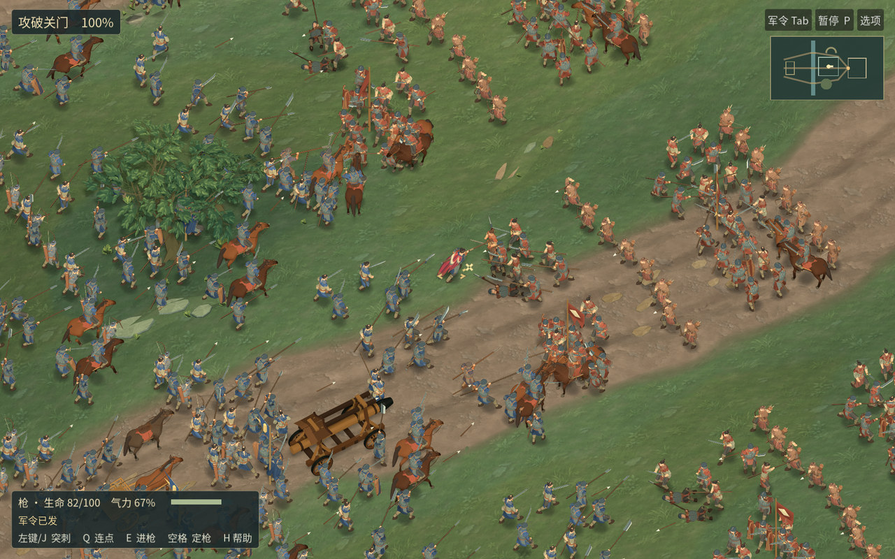

# 河关 0.16.0-rc.11 · 战马、望楼与正常游玩镜头

[下载 macOS 候选包](https://github.com/haohongfei2001-png/luanshi-game/actions/runs/43402644730/artifacts/14025269687) · [59.2 秒战役与战后实录](playthrough-review.mp4) · [1920×1200 正常视角](normal-native.jpg) · [帧时间与验收原始数据](measurements.json)

下载 Actions 附件，解开里面的 `Luanshi-macOS.zip`，打开其中的应用。内层 ZIP 的 SHA-256 为 `45a0317f4ad79072cee2476afcb7ab00d64e8721abe75dbf2d1aa83e27b2a0bc`。游戏源 `e66ce35cdd0f81df5b8a28fffefa09050923682f`，实际导出 `157a91a4f76830bd0ec09e4821dccc6a890ecaaf`，游戏合并 `59969ee84014a72f764aec1537787c58ae69edf1`，目录树 `21e7bc9998fb549db16c3ce61530d49320a6db14`。[游戏 PR #47](https://github.com/haohongfei2001-png/luanshi-game/pull/47) · [整包六项检查](https://github.com/haohongfei2001-png/luanshi-game/actions/runs/43402644730) · [Linux 包](https://github.com/haohongfei2001-png/luanshi-game/actions/runs/43402644730/artifacts/14026700962)



## 实机中改了什么

以前从斜上方望向关门，三片瓦面在一条线上连成块。这次抬高主楼，缩短侧楼屋檐，在门和两座望楼之间留出空隙。城墙正面改成偏灰的夯土，在望楼底部加上收分的石脚，窄令旗落在两楼之间。破门后近侧屋面能让出穿行兵群，回到远处仍看得到整楼。五个固定机位使用同一支实际军队。第 490 步 512 对 512 场上已累计 975 / 739 次命中，对照两侧的人数、兵籍、朝向、损失和相机均一致。初次孤立试作的变量重名影响了脚本导入，修正后重新跑了对照。 [城门全景前后](gatehouse-pair.jpg) · [已破门、近镜](gate-breach-pair.jpg) · [五组原始 PNG](https://github.com/haohongfei2001-png/luanshi-game/actions/runs/43399255144/artifacts/14024466696)

马肩到前腿、后腰到马臀共用连续轮廓，鞍后桥压低，队列马与近景马共享步态、毛色和眼鼻。在同一名真实骑手 150 号身上比较了左右侧、后四分之三、林隙和正常军阵。两次行程均为 9.9436 米，12 组同刻图像、每版 100 帧。近景马从 7050 降到 7010 个三角面，远景马从 1116 增至 1612；头口、眼与蹄的 252 / 120 个顶点保持逐项一致。第一遍仍显圆团的后臀与偏亮鞍缘已复修。 [肩臀侧面](cavalry-profile.jpg) · [马与步兵](cavalry-infantry.jpg) · [正常距离](cavalry-formation.jpg) · [骑行原片](https://github.com/haohongfei2001-png/luanshi-game/actions/runs/43400591082/artifacts/14025271558)

验证时也保留 RC10 的真实击打。第 43 步普通兵 102 被 612 击中，生命从 62 降到 44.48；第 79 步盾兵 70 挡下 576 号的攻击，生命从 26.54 降到 23.76。主角跟随镜头出枪前后，584 号敌兵从 62 降到 39.76。九武器各自通过正常普攻、快捷键和命中检查。上一个可回退包保留了左右承击动作制作与衣甲前后对照。 [RC10 实机及回退包](../river-gate-v1-rc10/PLAYTEST.md) · [RC11 全尺寸截图及 34 秒战线原片](https://github.com/haohongfei2001-png/luanshi-game/actions/runs/43402644730/artifacts/14026458379)

## 一场战役与战后

自然攻城录像录下 501 帧。冲车四轮的轮缘随车行进 47.10 米，第 518 步首次损伤城门，第 630 步冲开城门，第 1000 步因持续据有城内阵地结算。双方各有 512 名普通兵、16 名军官，主角另计。双方普通兵阵亡 270 / 298，军官独立取得 7 / 6 次击杀，发生 6 / 4 次继任。 [从开战到夺取内庭的录像及九武器实录](https://github.com/haohongfei2001-png/luanshi-game/actions/runs/43402644730/artifacts/14027311296)

从主菜单军议经部署、发令、实战、战报到驻营，正常输入录到 888 帧、59.20 秒，含双声道。两场 512 对 512 的冲车护送、骑马/下马、战车驾驶与下车、主动撤退、主角战败、战后继续行军和存读档均有独立验证。V3 和 V4 存档分别重演到第 235 和 746 步，同期参考的状态差异均为零。 [完整游玩录像](https://github.com/haohongfei2001-png/luanshi-game/actions/runs/43402644730/artifacts/14026507431) · [存档及护送记录](https://github.com/haohongfei2001-png/luanshi-game/actions/runs/43402644730/artifacts/14025719463)

## 冷启动与实战性能

候选包在托管 Apple M1 (Virtual)、Apple Paravirtual device (Apple5) 上运行。默认游戏实际绘制 1024×640、100% 内部比例、4× MSAA、保留阴影；系统窗口 1024×645。每方 512 名普通兵，24.00 秒，2442 个实际帧，区间 1159 次真实命中。平均 101.75 FPS，P50/P95/P99 为 6.42 / 26.38 / 49.37 毫秒，最长 134.22 毫秒，峰值进程 RSS 533.91 MiB。超出 60 / 90 / 120 Hz 单帧预算的帧数分别为 268 / 623 / 824。虚拟 GPU 时间戳不可用。 [原生窗口、逐帧记录和启动日志](https://github.com/haohongfei2001-png/luanshi-game/actions/runs/43402644730/artifacts/14025949272)

每轮从空的游戏数据目录启动，保留宿主系统和驱动缓存。九次包含两次兼容后端、两次默认 Metal、三个其他画质/采样配置、焦点切换控制和最终默认窗口；9/9 完成实际命中。

Linux 为 Ubuntu 24.04、Xvfb / llvmpipe、实际绘制 1280×800、100% 内部比例，每档记录 20 帧。软件光栅数据可复现负载和兵数，物理玩家设备的稳定帧率仍需独立测量。

| 每方普通兵 | 区间命中 | 平均 FPS | P50 ms | P95 ms | P99 ms | RSS MiB |
|---|---:|---:|---:|---:|---:|---:|
| 20 | 33 | 2.93 | 340.12 | 369.48 | 375.80 | 816.73 |
| 100 | 172 | 1.81 | 550.33 | 575.06 | 575.33 | 901.59 |
| 250 | 262 | 1.51 | 657.72 | 694.48 | 697.63 | 942.34 |
| 512 | 288 | 1.20 | 833.02 | 887.85 | 892.52 | 975.64 |

在同一台托管虚拟 M1 另做四场交叉验证，旧、新、新、旧，均运行实际下载的两个包。默认 1024×640、4× MSAA、每方 512、每场约 24 秒。RC10 的 P95 为 26.83 和 39.37 毫秒，RC11 为 28.79 和 23.99 毫秒，四场都没有稳定压入 16.67 毫秒。一处后处理精确时长断言将首段 23.999983 秒判失败。随后以 1 毫秒计时容差重读了相同的四份原始数据。 [同设备的全套原生记录](https://github.com/haohongfei2001-png/luanshi-game/actions/runs/43405285764/artifacts/14027227148) · [对原始数据的复验](https://github.com/haohongfei2001-png/luanshi-game/actions/runs/43406636411)

对 RC10 的三份既有 Mac 原始逐帧文件做了独立重读。763.73 毫秒的峰出现在 22.92 秒，距最后一次镜头平移已有 220 帧，与 223.22 和 281.82 毫秒的两帧成簇。另一台同树虚拟 M1 的最长帧 94.80 毫秒就在一次移镜后的第二帧。两类长帧的发生条件不同，GPU 未返回有效计时，根因不能从曲线单独判定。相同 CPU 场景此前确已测出呈现脚本 P95 下降 10% 至 14%。 [三个原始包的交叉测量](https://github.com/haohongfei2001-png/luanshi-game/actions/runs/43403214621) · [已测量的优化](https://github.com/haohongfei2001-png/luanshi-game/actions/runs/43392787042)

[主线独立重建状态](https://github.com/haohongfei2001-png/luanshi-game/actions/runs/43405594451)。

## 仍影响游玩的地方

默认缩放下重复的灰盔和同一排的持械姿态仍较明显。马匹背光一侧偏平，近侧骑兵或树冠仍会遮住一部分交手，城门切开时梁架偏直。整套美术仍需精修。真实 MacBook Air M5 的内屏与 27 英寸 4K 外屏、各持续 20 分钟的热稳态和 60/90/120 FPS 测试均为 NOT_RUN。

在托管 Ubuntu 24.04 / Godot 4.6.3 的干净检出运行以下命令可复拍：

```sh
./tools/prepare-font.sh
godot --headless --editor --path . --import
./tools/compare-river-art.sh
./tools/test-field-render.sh footage
./tools/test-field-journey.sh
./tools/test-field-render.sh journey
```

原生包复现命令为 `python3 tools/rc3_native_probe.py package/Luanshi-macOS.zip package/unpacked mac-evidence`。截图图集、完整录像、原生逐帧数据与内层 ZIP 校验各自归档。
