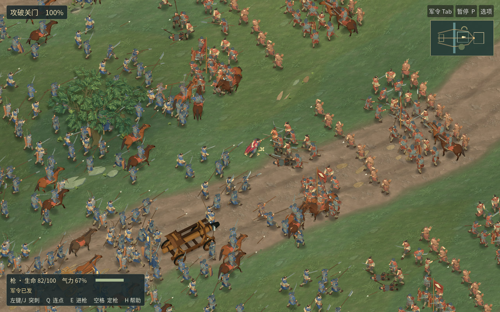

# 河关 0.16.0-rc.12 · 千人战场实机与 macOS 候选包

[下载 macOS](https://github.com/haohongfei2001-png/luanshi-game/actions/runs/43416566901/artifacts/14032437036) · [完整军议、战斗、战报到驻营实录](playthrough-review.mp4) · [默认跟随镜头原图](normal-native.jpg) · [盾兵在正常镜头里的改动](shield-issued-22m.jpg) · [完整原始数据](measurements.json)

下载外层 Actions 压缩包，解开其中的 `Luanshi-macOS.zip` 后打开应用。内层 SHA-256 为 `fb77da33cac71df38cc26ca80e7417741f750f86bb6118686cce278db12e6ee7`。游戏源 `5e12030486991d259c344b038605a13a70308ec7`，实际导出源码 `92900dc79e381509e878ac0008e62fa9c3e95ba4`，主线游戏合并 `e627086d985f0e458f187f4d691e816471574912`，三者目录树均为 `b720f844636c61bf924a7caf74258ff6b46c3433`。[源码 PR #49](https://github.com/haohongfei2001-png/luanshi-game/pull/49) · [候选 CI](https://github.com/haohongfei2001-png/luanshi-game/actions/runs/43416566901) · [Linux 包](https://github.com/haohongfei2001-png/luanshi-game/actions/runs/43416566901/artifacts/14032167558)



## 普通兵在游玩镜头里

枪兵 103 的轻盔在耳下打开，下颌和短布边露出。盾兵 70 的护颊、后颈是独立的片，盾牌接下一击时仍能分清头、肩和盾面。第一轮过亮的环形盔沿在二次实拍后撤掉。两版同种子 512 对 512 军队在 12 个机位经过同一批命中与伤亡。22 米下差别主要来自头肩轮廓，42 米仍靠长枪、盾牌与军阵辨认兵种。枪与盾的近、中、远六个网格重烘，另 30 个网格逐属性相同。队列档枪兵和盾兵分别增加 52、68 个三角面。 [枪兵](spear-jaw-pair.jpg) · [初版枪、盾造型和原图](https://github.com/haohongfei2001-png/luanshi-game/tree/e7ffdbc43ef553794ffb0a6877e66c79faf8779c/docs/evidence/river-issue-helmets)

RC11 的城门切顶仍有孤立枋木。本版把近檐与其托木移到屋面的可见节点，并在保留的远侧建立三间窗和有支撑的矮墙。第一轮图里发现两块托木还悬在士兵头上，第二轮将它们挂回实际柱顶。五个机位每帧均校验军籍。四个视角像素和旧包完全相同，真正会遮人的第 635 步局部发生变化。正常看主门与两座望楼的完整轮廓，冲入城门时能看见后排贴近前排前进。[破门实机前后](open-gallery-pair.jpg) · [五个机位及原始 PNG](https://github.com/haohongfei2001-png/luanshi-game/actions/runs/43408237669/artifacts/14028436977)

组合进游戏后，原固定盾兵近景检出了额头被遮住的问题。RC11 脸框有 19 个肤色像素、手框 106。第一次 RC12 变成 0 和 106。第一遍收盔沿只恢复到 3 个脸部像素。在第二遍建模中把前侧挂甲移回太阳穴，收起最突出的前缘，给眼眶和脸颊留出空间。三个盾兵 LOD 的三角面数和其余 33 个身体网格保持原样。在固定的同一受光、机位、分辨率与采样阈值下，正式包复测脸部 13、手部 106 个肤色像素。十余像素的小框只说明皮肤没有被实物挡住，可以在实际尺寸下比较轮廓。 [盔口返工前后](portrait-fit-pair.jpg) · [22 米](shield-issued-22m.jpg) · [42 米](shield-issued-42m.jpg) · [完整 12 对窗口](https://github.com/haohongfei2001-png/luanshi-game/actions/runs/43414416378/artifacts/14030563351) · [第一次返工的失败记录](https://github.com/haohongfei2001-png/luanshi-game/actions/runs/43413102255/artifacts/14030013476) · [先前固定镜头](portrait-before.jpg) · [被退回的盔沿](portrait-rejected.jpg) · [修复后](portrait-shipping.jpg)

两轮游戏已有裙甲、实际承击与出枪、原生四轮冲车、近远坐骑连续肩臀及完整轮廓。另有 15 组 1920×1200 配对、连续 34 秒实际战线，以及 22 米玩家亲战和受创记录。[RC12 满幅画面与连续战线](https://github.com/haohongfei2001-png/luanshi-game/actions/runs/43416566901/artifacts/14032804033) · [RC11 战马、门楼与可退回的安装包](../river-gate-v1-rc11/PLAYTEST.md)

## 军事目标与战后

每方 512 名普通兵，另有 16 名军官，另有全场一名玩家。501 帧攻城原片从开始持续到战报。冲车行过 47.10 米，四个轮缘转过 47.10 米；城门第 518 步首次失血，第 630 步破门，第 1000 步因占据内庭结算。双方普通兵阵亡 270 / 298，军官独立击杀 7 / 6、继任 6 / 4。双方持有的箭矢和生还人员通过结算。 [不间断攻城原片与武器实操](https://github.com/haohongfei2001-png/luanshi-game/actions/runs/43416566901/artifacts/14032912265)

剑、刀、棍、枪、长刀、弓、弩、剑盾、双剑逐项接受正常输入并取得 3、2、3、3、3、5、3、3、5 次真实命中。主角在普通跟随镜头第 43 步出枪，第 48 步刺中 584 号，生命从 62 降至 39.76。两条冲车护送、军令响应、独立将领、救援与继任、骑乘与战车均通过回归。完整 GUI 录像包含军议、部署、玩家攻击、破门、战报、驻营，导出 888 帧、59.20 秒、双声道。V3/V4 旧档分别演算至第 235 / 746 步，校验字段与各自参考一致。 [连续有声旅程](https://github.com/haohongfei2001-png/luanshi-game/actions/runs/43416566901/artifacts/14032887811) · [护送、存读档及战后流程](https://github.com/haohongfei2001-png/luanshi-game/actions/runs/43416566901/artifacts/14032428754)

## 原生 macOS 与各规模实测

候选在 Apple M1 (Virtual)、Apple Paravirtual device (Apple5)，系统窗口 1024×645、实际和内部绘制 1024×640、100% 比例、4× MSAA、阴影开启。采样 24.00 秒、3470 帧，同区间 1146 次真实命中。九次从空游戏数据目录启动，系统驱动缓存保留，9/9 进入战斗并记录命中，包括兼容后端与默认 Metal。 [原生首帧、启动和原始逐帧数据](https://github.com/haohongfei2001-png/luanshi-game/actions/runs/43416566901/artifacts/14033271911)

| 原生窗口 | 平均 FPS | P50 ms | P95 ms | P99 ms | 最长帧 ms | 峰值 RSS MiB |
|---|---:|---:|---:|---:|---:|---:|
| 候选 Apple M1 (Virtual) | 144.57 | 5.46 | 14.29 | 18.41 | 686.19 | 528.33 |
| 同树 main Apple M1 (Virtual) | 66.46 | 9.89 | 35.46 | 51.08 | 635.42 | 526.00 |

候选 最长帧 686.19 毫秒发生在第 2283 帧（从零计），游戏步 426→429，画面内 252 名士兵。该帧累计模拟 47.14 毫秒、画面脚本 2.69 毫秒，渲染 CPU 设备计时 0.20 毫秒。距上次请求移镜 23 帧。 虚拟适配器没有提供有效的 GPU 时间戳。其余耗时仍未归因。 主线重建 最长帧 635.42 毫秒发生在第 0 帧（从零计），游戏步 102→105，画面内 400 名士兵。该帧累计模拟 75.89 毫秒、画面脚本 6.58 毫秒，渲染 CPU 设备计时 0.29 毫秒。当时尚未请求第一次移镜。 [主线 CI](https://github.com/haohongfei2001-png/luanshi-game/actions/runs/43419880003)

Linux 托管 Ubuntu 24.04 的 Xvfb / llvmpipe 图形运行使用 1280×800、全内部比例，各规模 20 个真实绘制帧。

| 每方普通兵 | 采样内命中 | FPS | P50 ms | P95 ms | P99 ms | RSS MiB |
|---|---:|---:|---:|---:|---:|---:|
| 20 | 33 | 4.81 | 209.53 | 222.35 | 243.37 | 817.42 |
| 100 | 172 | 3.04 | 327.13 | 345.86 | 348.07 | 895.00 |
| 250 | 262 | 2.49 | 397.13 | 441.45 | 445.86 | 953.24 |
| 512 | 288 | 1.94 | 513.58 | 545.84 | 570.47 | 991.88 |

实战仍可能出现长帧。曾在单个虚拟 M1 上对 RC10/RC11 按旧、新、新、旧交替运行，比对的四次 P95 在 23.99 至 39.37 毫秒之间。RC12 的峰值时刻现已配对到确切游戏步和原生帧，普通玩家运行无需开启此采样。 [之前各宿主与同宿主差异](../river-gate-v1-rc11/PLAYTEST.md)

## 自审与复现

密集前线里的武器重叠、同排步兵姿态的重复、背光马身色块及树冠挡人仍然明显。单个角色的头甲可读性改善，整排小人仍缺少足够自然的轮廓变化。真实 MacBook Air M5 内屏和 27 英寸 4K 外屏、各 20 分钟热稳态与 60/90/120 FPS 验证均为 NOT_RUN。正式文学剧情继续留白。

复现上述窗口使用 Godot 4.6.3 的托管 Ubuntu 24.04 图形会话。

```sh
./tools/prepare-font.sh
godot --headless --editor --path . --import
./tools/compare-river-art.sh
./tools/test-field-render.sh footage
./tools/test-field-journey.sh
./tools/test-field-render.sh journey
```

托管 macOS 对正式包运行 `python3 tools/rc3_native_probe.py package/Luanshi-macOS.zip package/unpacked mac-evidence` 并读取原始峰值区间进行核对。
