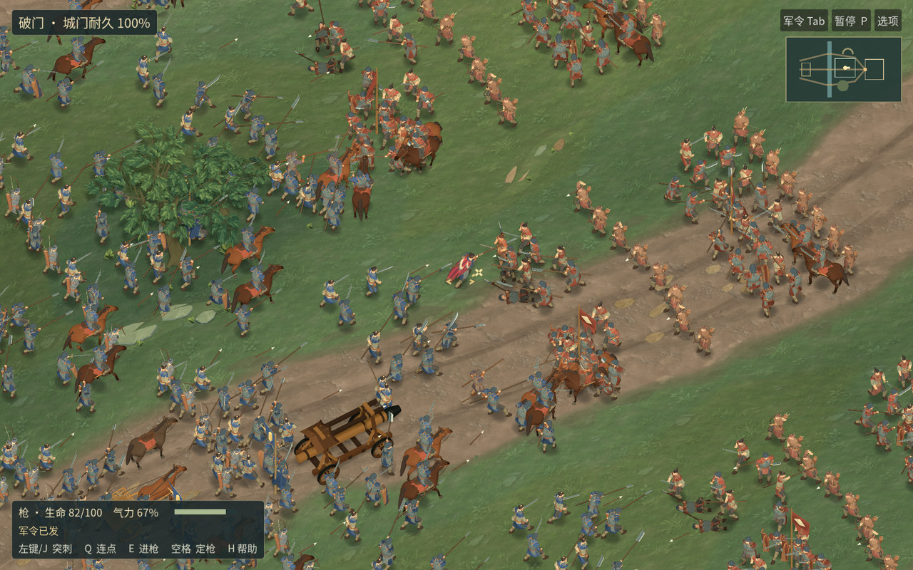

# 河关 0.16.0-rc.13 · 实机与下载

[macOS 试玩包](https://github.com/haohongfei2001-png/luanshi-game/actions/runs/43426014852/artifacts/14037602462) · [军议到驻营的实录](playthrough-review.mp4) · [正常跟随镜头原尺寸](normal-native.jpg) · [九类武器与完整围城录像](https://github.com/haohongfei2001-png/luanshi-game/actions/runs/43426014852/artifacts/14037834899) · [逐项数据](measurements.json)

解开 GitHub Actions 附件与其中的 `Luanshi-macOS.zip`，打开应用。此版使用开发用临时签名。内层包 SHA-256 是 `414720c7f1578db7c9558972503875497463dd5457bfda1011e49824a37f131c`。游戏源码 `03acb69b1621130f92bd940caa2cfb3b4e8653a5`、导出提交 `c96563beff02a8ad4f24458a228dcd426b4e2a72`、主线合入 `12bdc945b7bb4ce2db655555a567244984496e45` 的游戏树相同，均为 `84300e14ec89b35da34acc5c610146af7c0dfe6d`。 [游戏 PR](https://github.com/haohongfei2001-png/luanshi-game/pull/51) · [候选构建与验证](https://github.com/haohongfei2001-png/luanshi-game/actions/runs/43426014852)

## 普通跟随视角

普通步兵此前有独立步相，但同排枪盾的肩、胯、肘仍共用一组携行重心。第一轮站定时高举枪尖在一轮内移动了 0.869 米，普通镜头看起来在左右晃，已退回。现在前排会根据真正锁定的敌兵是否迎面接近，依次压低枪线、收肩入盾；后排继续持械前进。站定高举枪的同一跨度降至 0.156 米。原始 22 米镜头跟随 73 帧、阵线 68 帧，参与者、位置、动作步和命中相同。部分后排角度仍相近。 [主角第一次命中前后](infantry-contact-pair.jpg) · [冲车前四个时刻](infantry-weight-sequence.jpg) · [两版正常速度并排影片和完整 1920×1200 窗口](https://github.com/haohongfei2001-png/luanshi-game/actions/runs/43421536192/artifacts/14034732731)。

中桥至城门的 72 米官道有单独绘制的断续轮辙、路肩裸土和靠城碎石。第一次垫高的土片在草上出现游离的三角形，已退回；重新把轮辙贴着实际道路绘制，又降低了第二遍画面中过于规则的深色轮痕。第三遍在完整跟随画面中仍可识别其走向。界面分别显示剩余城门耐久和破门后的内庭占领时间。 [同机位全幅](road-pair.jpg) · [原像素路面](road-detail.jpg) · [原始 PNG 与相同输入](https://github.com/haohongfei2001-png/luanshi-game/actions/runs/43422041385/artifacts/14034976176)。

[第 43 步起手、第 48 步命中与 15 组正常镜头](https://github.com/haohongfei2001-png/luanshi-game/actions/runs/43426014852/artifacts/14040020396) · [上一版的头甲、门楼与完整可回退包](../river-gate-v1-rc12/PLAYTEST.md)

## 连续战役

河关军议出发，双方各有 512 名普通兵及 16 名军官，玩家单列。九类武器接受游戏原有输入，剑、刀、棍、枪、长刀、弓、弩、剑盾、双剑分别发生 3、2、3、3、3、5、3、3、5 次真实命中。军令传递、将领交手与继任、骑乘、战车和两条护送路径均有回归。正常镜头里，玩家击中同一名 584 号士兵，生命由 62 降为 39.76。

固定种子的完整攻城在第 630 步破门，冲车实际行驶 47.10 米，第 1000 步占据内庭而胜。双方阵亡 270、298 名普通兵，守方仍有 214 名未阵亡。战后结算、驻营、行军及跨进程存读档均通过，V3/V4 旧档分别延续至原有第 235 和 746 步。实录 888 帧、59.20 秒、双声道。[GUI 测试记录、战报和原图](https://github.com/haohongfei2001-png/luanshi-game/actions/runs/43426014852/artifacts/14036669538)

## 实测

Godot 4.6.3，托管 Apple M1 (Virtual)，Apple Paravirtual device (Apple5)。系统窗口 1024×645，默认画质实际图像 1024×640，100% 内部比例、4× MSAA，阴影开启。1920×1200 图像来自另外的 Linux 画面验证。用正式 ZIP 连续采样 24.02 秒、2160 帧、1159 次真实命中。独立应用数据目录启动 9/9，系统驱动缓存保留。

| 512 对 512 默认包 | 平均 FPS | P50 ms | P95 ms | P99 ms | 最长 ms | 峰值 RSS MiB |
|---|---:|---:|---:|---:|---:|---:|
| 候选 | 89.92 | 8.05 | 26.08 | 35.20 | 151.79 | 535.59 |
| 同树主线 | 119.98 | 6.42 | 18.79 | 26.66 | 61.02 | 528.52 |

候选最长帧出现于步 364→365，当时有 356 名普通兵在视野内。该帧采到模拟 144.17 ms、画面脚本 5.47 ms，未取得有效 GPU 设备时间戳。 [主线独立构建与测试](https://github.com/haohongfei2001-png/luanshi-game/actions/runs/43430982094) [原生逐帧文件与启动日志](https://github.com/haohongfei2001-png/luanshi-game/actions/runs/43426014852/artifacts/14038228511)

同一游戏树独立重建后，第 1870 帧是这一轮最长帧，位于步 422→422，当时画面内 248 名普通兵，距离上次请求移镜 2 帧。采到模拟 0.00 ms，画面脚本 6.55 ms。两轮均未取得可用的虚拟 GPU 时间戳。主线 9/9 次也从空游戏数据目录进入交战。

另在托管 Linux 按同一初始军籍、弓与号角命令重跑四遍，逐步测空间格、将领/命令、寻敌、士兵状态和密度、箭矢、冲车与胜负。第 365 步分别 7.13、7.34、7.34、7.28 毫秒。其中兵员状态和密度的开销最大。Linux 的回放省略了 macOS 窗口、镜头和按键巡测，不能据此归因或消除原生包的长帧。[四次原始记录](https://github.com/haohongfei2001-png/luanshi-game/actions/runs/43429027173/artifacts/14038169997)

| Linux llvmpipe · 每方人数 | 采样命中 | FPS | P50 ms | P95 ms | P99 ms | RSS MiB |
|---|---:|---:|---:|---:|---:|---:|
| 20 | 33 | 2.87 | 351.26 | 371.52 | 378.67 | 824.29 |
| 100 | 172 | 1.78 | 562.56 | 588.10 | 591.17 | 901.66 |
| 250 | 262 | 1.48 | 675.90 | 712.27 | 716.09 | 940.96 |
| 512 | 288 | 1.16 | 854.43 | 919.60 | 921.91 | 987.50 |

四个规模均在 Ubuntu 24.04 软件光栅化的 1280×800 真窗口各采 20 帧。真实 MacBook Air M5 内屏与 4K 外屏的 20 分钟热稳态以及 60/90/120 FPS 均未测。独立宿主之间的 FPS 不能用来推断某一项美术改动加快或拖慢了游戏。默认镜头下前排枪杆仍会互相遮住，背光马身和树林剪影仍显平，整套美术继续保留待验收状态。

复现使用同一提交的 `./tools/prepare-font.sh`、`godot --headless --editor --path . --import`、`./tools/compare-river-art.sh`、`./tools/test-field-render.sh footage`、`./tools/test-field-journey.sh`、`./tools/test-field-render.sh journey`。托管 Mac 使用 `python3 tools/rc3_native_probe.py package/Luanshi-macOS.zip package/unpacked mac-evidence`。
