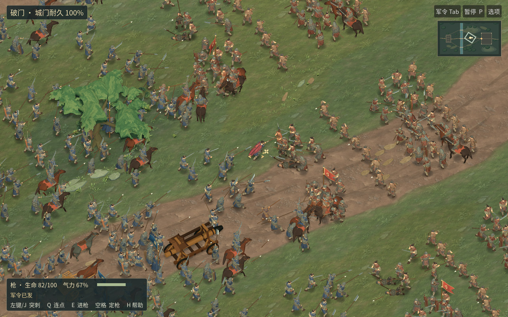

# 河关 RC14 · 实际交付与未过项目

[下载 macOS 候选 ZIP](https://github.com/haohongfei2001-png/luanshi-game/actions/runs/43466044060/artifacts/14059641456) · [22 米实际游戏窗口](normal-camera-before-after/after.png) · [完整逐帧 Metal 数据](native-frame-times.json) · [实际画面审核](artref-verdict.md)

本安装包对应游戏源 `8a911eb8d77a4a5d0d2179b5304697dd9fa3db4d`、导出合成提交 `584870655703f3b7f7cfd927500880ce4d966818`。完整 Git 树有九个说明文件不同，游戏和资源相同。解开 Actions 附件，再解开其中的 `Luanshi-macOS.zip`。内层 SHA-256 为 `14ca7fdbdabd4a36e581a0fab73b9e04f2f73c3da6a0023ca374b5ea8f4cc6c8`。[源码 PR](https://github.com/haohongfei2001-png/luanshi-game/pull/53) · [导出差异](https://github.com/haohongfei2001-png/luanshi-game/compare/8a911eb8d77a4a5d0d2179b5304697dd9fa3db4d...584870655703f3b7f7cfd927500880ce4d966818)

固定种子 61112。512 对 512 名普通兵，军官与主角单列。战役从军议、部署、选弓、发号、到破门、占内庭、还营及存读档，于第 1030 步自然结算。该局主角实际击中 7 次，战后时间加 1 小时。独立攻城基准于第 629 步破门、第 1000 步占内庭。撤离、战败、九种武器、骑乘战车、将领救护与继任、v3/v4 老存档的记录保存在 CI。[逐项实测](measurements.json) · [九武器与自然攻城影片](https://github.com/haohongfei2001-png/luanshi-game/actions/runs/43466044060/artifacts/14058419041)

工程回归有一个明确缺口。两次护送均出现真实胜利报告，第二局的战报在第 700 步出现。托管软件渲染进程随即用完外层 900 秒，最后一次点击随军营地未得到完成日志；该任务为失败。主战役已经单独输出完整 59.20 秒、888 帧、立体声及战后营地证据。影片上传原先与后续护送共用成功条件，已在后续分支修正，保留这次失败。[CI 全记录](https://github.com/haohongfei2001-png/luanshi-game/actions/runs/43466044060) · [七个窗口与战报](https://github.com/haohongfei2001-png/luanshi-game/actions/runs/43466044060/artifacts/14060087240)

**发行包实际回放**。Linux 同版二进制直接接收键鼠，实开 1280×800、内部同尺寸、4× MSAA。片长 40 秒/960 帧、24 帧录制、双声道，峰值 −11.1 dB。第二次由阵后短步、连续发令与正常移镜记录真实交战至第 774 步，窗口范围中实际记下 2081 次命中、守军城门从 260 降为 0。保存时保留第一次上前后阵亡的[原始败战](first-defeat.mp4)。[实际包录像](combat-normal-speed.mp4) · [按键与战斗记录](export-recording.json)

**托管 Mac**。Apple M1 (Virtual)，原生游戏窗口 1024×645，GPU 附件及内部 1024×640、100%、4× MSAA、阴影开启。24.00 秒中 1159 次命中、3782 帧。平均 157.57 FPS，P50 5.323 ms、P95 13.199 ms、P99 16.640 ms，最长 48.718 ms；37 帧超过 16.67 ms，峰值常驻 815.7 MiB。9 次新进程/空游戏数据目录进入战斗；各次保留系统与图形驱动缓存。**真实 M5 20 分钟热稳态、内屏与外接 4K 未测。** [原生包启动日志](https://github.com/haohongfei2001-png/luanshi-game/actions/runs/43466044060/artifacts/14061330294)

| Ubuntu 24.04，llvmpipe，每方人数 | FPS | P50 ms | P95 ms | P99 ms | RSS MiB |
|---:|---:|---:|---:|---:|---:|
| 20 | 3.46 | 292.386 | 306.583 | 307.927 | 930.6 |
| 100 | 2.36 | 421.568 | 454.878 | 457.6 | 1009.6 |
| 250 | 2.07 | 491.808 | 507.01 | 510.936 | 1070.6 |
| 512 | 1.70 | 586.599 | 632.5 | 633.499 | 1124.1 |

每档 1280×800、100%、4× MSAA、每档约 20 帧，含交战和切换观察区域。四档短窗与虚拟 M1 的数据不能外推为目标设备结果。

以 `./tools/prepare-font.sh`、`godot --headless --editor --path . --import`、`./tools/test.sh`、`./tools/compare-river-art.sh`、`./tools/test-field-render.sh footage`、`./tools/test-field-journey.sh`、`./tools/test-field-render.sh journey` 复现。托管 macOS 源命令为 `python3 tools/rc3_native_probe.py package/Luanshi-macOS.zip package/unpacked mac-evidence`。游戏素材与后续独立试作见 [来源](assets-and-licenses.md) 和 [试作及退回记录](STUDIES.md)。
