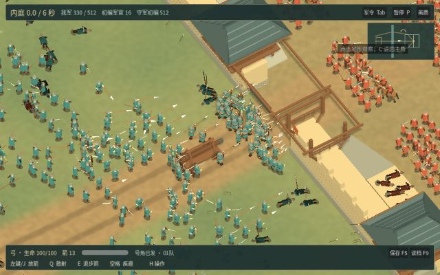

# 河关战役 0.16.0-rc.2

从军议选好兵器、下令开战，经过城门、战报和行军，再读回营地。可执行程序、录像和测量均取自主线 [71889537db0d](https://github.com/haohongfei2001-png/luanshi-game/commit/71889537db0d74b9cf6f372d50c830e9e5e32278) 的同一次构建。[主线检查](https://github.com/haohongfei2001-png/luanshi-game/actions/runs/43157917697) · [RC2 改动 #29](https://github.com/haohongfei2001-png/luanshi-game/pull/29) · [上一候选与九兵器动作表](../river-gate-v1-rc1/PLAYTEST.md)

## 下载

解开外层 Actions 归档，再解开其中的 `Luanshi-macOS.zip`，打开 `Luanshi - Border Skirmish.app`。macOS 包内层的 SHA-256 为 `ce539ea4e08477838d24df6d3d437b6057a8fd00ab77361172a07d672ed9c930`。托管 Mac 已校验签名结构，并用这个包开窗验证。构建采用项目现有的临时签名，未办理 Apple 公证。Actions 列出的到期日为 2027-02-10 UTC。[macOS 试玩包](https://github.com/haohongfei2001-png/luanshi-game/actions/runs/43157917697/artifacts/13917576349) · [Linux 包](https://github.com/haohongfei2001-png/luanshi-game/actions/runs/43157917697/artifacts/13917327011) · [中文操作](../../PLAYING_ZH.md)

## 完整战役实录

这局含 1024 名普通兵、32 名军官及玩家。主角造成 7 次命中，军令送达 1 次。内庭占领 6.0 秒后，第 1030 步出现「夺取城内阵地」。双方普通兵各阵亡 257 / 308，各命中 1431 / 1084 次。玩家行军 1 小时再读档，军籍和营地保留。[看录像](playthrough.mp4) · [战前](journey-01-muster.jpg) · [两军接敌](field-contact.jpg) · [随主角交战](journey-04-contact.jpg) · [结算](journey-06-report.jpg) · [战后](journey-07-camp.jpg)

默认护送部署第 724 步破门时，冲车距门 3.0 米，已在交付范围，取得「护送冲车成功」，守军保住城池。在另一场把前队调去攻门的护送中，破门时冲车距门 9.9 米，顶栏提示「送车入门 · 距门 10 米」。送达后显示「护送冲车成功」，进入营地显示「战后随军」。另在窗口内打出「成功撤离」与「主将阵亡」。平陵行军从三城军籍实际派出 27 / 14 名普通兵，撤离后 34 人随军、26 人留作后卫。更大规模的战中恢复样本为 641 / 389 名普通兵。[送车途中](journey-escort-open-gate.jpg) · [护送战报](journey-escort-report.jpg) · [巡防](journey-patrol-muster.jpg)

早期实录的护送战报顶栏仍留着撞门次数。修正后，首轮回归错误地要求每场交车都出现途中提示。默认部署破门时已进入交付范围，先锋先行才出现途中阶段。两种部署已从界面分别复测。[保留的失败回归](https://github.com/haohongfei2001-png/luanshi-game/actions/runs/43153519636) · [两种走法的窗口复测](https://github.com/haohongfei2001-png/luanshi-game/actions/runs/43155329275)

所有九种兵器的普通攻击、Q、E、空格及格挡或闪避都通过真实键鼠入口。各短片的命中次数为 剑 3、刀 2、棍 3、枪 3、长刀 3、弓 5、弩 3、剑盾 3、双剑 5。骑马和战车均完成上乘、转向、发动动作及下乘。兵器实录、完整攻城、带声旅程和千人镜头都在同一下载中。原旅程为 H.264 / 双声道 AAC，59.1 秒，音轨峰值 -10.6 dB、平均 -32.7 dB。声音的主观辨识度仍待真人试听。原文件 SHA-256 为 `e74d03df8a55cbc9747e4bdecb23ff3d1eba765effbbfd3deb13a9f0359f80f4`。仓库审阅副本 897470 字节，SHA-256 为 `c60a017b5907fb8ba0d01fef13e40cb913cd674095f583dd90ed94834c192130`。[全部录像](https://github.com/haohongfei2001-png/luanshi-game/actions/runs/43157917697/artifacts/13916892891) · [持盾步兵原画面](soldier-close.jpg)

双边军官交手、负伤救离、俘获与继任已在固定场景回归。主将阵亡后，有战力的士兵继续作战。成长主角或单名敌将在河关一战中累计击败数十名普通兵，仍缺连续实录。正式文学剧情留给作者，海战与火炮保留为历史选材。原版引擎分别写入 v3 与 RC1 的 v4 存档，再交由本版接续。v3 从 161 到 235 步，v4 从 629 到 746 步，所有被对照的历史字段一致。[军官、存档和车辆原始结果](measurements.json)

## 破门后的六秒

在门内可通行的地面上，士兵继续沿所在列向前。实验使用相同军籍、守军与军令。每行是同种子的 RC1 → 新走法。折返列只数门前最后 3.6 米内，正在行军的普通兵单步向后超过 1 厘米的样本。门线列数实际由西向东跨过门洞中心线的独立士兵，门内列数观察到越过内侧门槛的独立士兵。

| 种子 | 折返步进样本 | 跨过门线人数 | 到达门内人数 | 门口 3 米格峰值 | 新版车体内样本 |
| ---: | ---: | ---: | ---: | ---: | ---: |
| 61112 | 337 → 46 | 74 → 74 | 59 → 61 | 14 → 14 | 0 |
| 61113 | 504 → 115 | 79 → 82 | 70 → 74 | 15 → 13 | 0 |
| 61203 | 474 → 86 | 75 → 82 | 65 → 70 | 14 → 14 | 0 |

六场比较均保持真实伤亡并占领内庭。主线对同一基准种子再次测得 46 次折返、74 人跨线、61 人进入门内。桥面、行进中的冲车和旧存档的原路线继续生效。[标准种子](https://github.com/haohongfei2001-png/luanshi-game/actions/runs/43150230578) · [两个独立种子](https://github.com/haohongfei2001-png/luanshi-game/actions/runs/43150554277)

## 帧时间、人数与内存

Ubuntu 24.04 / X11 使用 llvmpipe (LLVM 20.1.2, 256 bits)，窗口 1280×800。RSS 使用 MiB。模拟步 P95 取另一次相同规模的固定步进采样。[Linux 帧记录与图像](https://github.com/haohongfei2001-png/luanshi-game/actions/runs/43157917697/artifacts/13917152567)

| 每方普通兵 | FPS | P50 ms | P95 ms | P99 ms | RSS MiB | 采样期间命中 | 模拟步 P95 ms |
| ---: | ---: | ---: | ---: | ---: | ---: | ---: | ---: |
| 20 | 25.7 | 39.47 | 43.23 | 65.01 | 343 | 42 | 0.49 |
| 100 | 20.5 | 48.90 | 51.52 | 52.58 | 365 | 186 | 2.43 |
| 250 | 16.6 | 58.82 | 68.01 | 76.07 | 376 | 303 | 6.62 |
| 512 | 10.1 | 97.05 | 128.56 | 129.58 | 390 | 343 | 17.23 |

托管 Apple M1 (Virtual) / Apple Paravirtual device (Apple5)。六次均有 512v512 真实交战，请求窗口 1000×600，根渲染目标 720×450。内部像素数按该目标乘各档 3D 缩放估算。关垂直同步，RSS 为进程峰值。[macOS 原生图像与逐帧数据](https://github.com/haohongfei2001-png/luanshi-game/actions/runs/43157917697/artifacts/13917073833)

| 画质或后端 | 估算内部尺寸 | 太阳阴影 | 秒 | FPS | P50 ms | P95 ms | P99 ms | RSS MiB | 命中 |
| --- | --- | --- | ---: | ---: | ---: | ---: | ---: | ---: | ---: |
| OpenGL 兼容，首次 | 720×450 | 开 | 9.7 | 12.4 | 75.63 | 138.53 | 231.57 | 328 | 979 |
| 清晰，首次 | 720×450 | 开 | 3.5 | 102.6 | 5.91 | 27.06 | 36.42 | 390 | 413 |
| 清晰，巡场 | 720×450 | 开 | 24.0 | 121.9 | 5.69 | 21.93 | 30.29 | 342 | 1147 |
| 均衡 | 612×383 | 开 | 3.5 | 90.8 | 6.64 | 31.71 | 40.70 | 344 | 404 |
| 性能 | 504×315 | 关 | 3.5 | 62.3 | 8.89 | 43.31 | 67.93 | 342 | 404 |
| OpenGL 兼容，复测 | 720×450 | 开 | 4.3 | 28.1 | 33.83 | 61.22 | 90.35 | 315 | 529 |

该主线运行首次启动 OpenGL 兼容窗口时停在第 0 步，期间命中为零。测试按失败保留了截图与日志。仅原生 Mac 检查使用同一份内层 ZIP 再测。上表取成功完成的六个窗口，首次无接战的画面未计入战斗性能。单次停步的触发原因尚待定位。[首次失败日志](https://github.com/haohongfei2001-png/luanshi-game/actions/runs/43157917697/job/130986662440) · [重测原始日志](https://github.com/haohongfei2001-png/luanshi-game/actions/runs/43157917697/job/130988538015)

巡场记录 2927 帧，渲染 CPU P95 为 0.49 ms，GPU P95 在该宿主没有有效读数。引擎接受三个动作到提交对应画面分别为 9.00 / 5.94 / 11.96 ms。物理键鼠到显示屏延迟、M5 Air 内屏和外接 4K 上持续至少 20 分钟的 512v512 接战仍待实机验证。短时云端样本无法用于推算这些结果。

## 仍影响试玩的三项问题

1. 门洞中守军和前排会自然遮住主角的出手。已减少门楼和上层廊板遮挡，近身多人交锋仍值得跟拍，重点看起手、盾挡和受击能否分清。
2. 瓶颈处仍会排队。三个种子的实际通行增幅有限，尤其标准种子跨门线人数持平。后续应检查门内对手是否正在接战，再决定哪里需要继续分流。
3. M5 Air 的散热、原生分辨率和长尾帧为 `DEVICE_NOT_TESTED`。当前记录器可由 `-- --field-profile` 打开，真实交战的原始帧会写入 JSONL。

在完整 Git 历史与 Godot 4.6.3 下，从本页源提交依次运行 `./tools/prepare-font.sh`、`./tools/test.sh`、`./tools/test-field-journey.sh`、`./tools/test-field-render.sh` 及 `./tools/export.sh`。托管 macOS 26 arm64 使用同一导出包实测。[逐步命令和输出](https://github.com/haohongfei2001-png/luanshi-game/actions/runs/43157917697)
