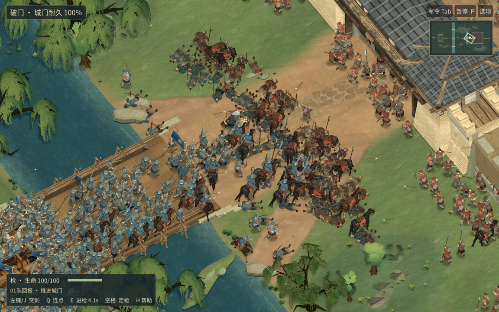

# 河关 RC22 · 桥头攻门实机

[▶ 1600 × 1000 原速原声实录](https://raw.githubusercontent.com/haohongfei2001-png/luanshi-game/c6fc9d564244eaca4c9c40ba9b3bf3a7e207312d/docs/evidence/river-gate-v1-rc22/bridgehead/river-gate-bridgehead.mp4) · [▶ 托管 Mac 上直接录制的候选包窗口](https://raw.githubusercontent.com/haohongfei2001-png/luanshi-game/fd411e7e6e1209d5d3b1ea84e05005771735e35e/docs/evidence/river-gate-v1-rc22/native-bridgehead/hosted-bridgehead.mp4) · [下载同一 macOS 候选包](https://raw.githubusercontent.com/haohongfei2001-png/luanshi-game/9ed812d8dd8036ea92d54c3f77a17e58b771e22c/candidate/River-Gate-RC22-macOS.zip)



22 米正交镜头，俯角 50.78°，水平角 −33°。以种子 61112 从常规军议开战，双方各 512 名普通兵及 16 名军官。第一条是 Godot 连续绘制的 798 帧，100% 内部渲染分辨率，4× MSAA，24 帧/秒，33.25 秒，立体声。第一张与最后一张之间没有剪切、推拉、插帧或后期锐化。第一轮游戏窗口实录输出只有 1280 × 800；此处所列版本按像素核对引擎写出的无损帧与编码后的 1600 × 1000。视频 SHA-256 `7a05ad133b6a1184a305b852af39ac6af01d219b822c8e91a08a406a265463ba`。[原帧、逐步输入和校验](https://github.com/haohongfei2001-png/luanshi-game/tree/c6fc9d564244eaca4c9c40ba9b3bf3a7e207312d/docs/evidence/river-gate-v1-rc22/bridgehead) · [较早的 1280 × 800 原片](https://raw.githubusercontent.com/haohongfei2001-png/luanshi-game/8ec7268da7987c354e0cfb4719e3c61cb9a8cc3a/docs/evidence/river-gate-v1-rc22/bridgehead/river-gate-bridgehead.mp4)

视频约第 7 秒可见浅色披肩的主角沿桥侧进枪，随后退回己方前排。这一段记录到 5 次画面内普通盾兵承击、至少 12 次普通枪兵造成的接触和 1 道送达军令。360 名从西岸出发的普通兵抵达桥东，门耐久归零。

第二条直接记录正式导出应用的 macOS 窗口，33.83 秒，1024 × 674（含标题栏），应用真实渲染 1024 × 640，有一轨游戏音频，保留系统原来的时间戳。关掉录像后在同一镜头独立量到 1619 个实际绘制间隔，24.78 秒、平均 65.34 FPS，P50 / P95 / P99 为 11.872 / 30.663 / 62.157 毫秒，最长 291.089 毫秒，670 次命中。单次可见普通兵最高为 705。这个桥头样本没有返回可信的进程内存读数，另一个默认窗口采样的 RSS 见下表。[实际窗口、原始间隔和菜单截图](https://github.com/haohongfei2001-png/luanshi-game/tree/fd411e7e6e1209d5d3b1ea84e05005771735e35e/docs/evidence/river-gate-v1-rc22/native-bridgehead)

操作入口为军议的「全军 → 桥头攻门」，选好兵器后按 Enter。桥宽 7.4 米，主角、两支东岸先锋、西岸后军、守门部队、冲车都在同一战场。WASD 走位，鼠标瞄准，长枪 E 为进步刺。画面里浅色披肩和脚边两段短线属于主角，蓝军从左下过桥，红军在右上城门前布防。

固定种子的独立战后回归于第 112 个战斗秒得到「守城成功」，两军普通兵阵亡 316 / 292。已核对内庭仍有守兵、城门被打破、军籍和箭矢账相符，以及驻营、等待、保存、重载和继续行军。第一轮同种子曾僵持 300 秒，保留了失败与修复后的日志。短片记录的是桥头首轮接触，战后回归使用单独的输入。[原始运行](https://github.com/haohongfei2001-png/luanshi-game/actions/runs/43533921991) · [复测](https://github.com/haohongfei2001-png/luanshi-game/actions/runs/43534219405)

角色步行在负重脚上换髋，长枪前手承重、后肘跟进，盾兵受击时盾位留在胸前、按来向屈臂。九种兵器的常规点击与 Q/E/空格逐项打出了预期动作，坐骑、战车和换位通过实际输入。最初的头像测试仍在旧几何位置取色，实拍里取样点已经移到盔顶；转为按受测士兵的骨骼投影后，在相同阈值下读到脸部 76、手部 52 个肤色像素。[两侧盾击原片](https://github.com/haohongfei2001-png/luanshi-game/tree/bff9e6be588f16c086e7dffc6856a678ef767cb9/docs/evidence/river-gate-v1-rc22/shield-brace) · [持械行步原片](https://github.com/haohongfei2001-png/luanshi-game/tree/703ce4e31b82c2ee130631d324cd6387fac280ae/docs/evidence/river-gate-v1-rc21/loaded-advance) · [头像复测](https://github.com/haohongfei2001-png/luanshi-game/actions/runs/43537874118)

试玩包为双架构 macOS 应用，构建号 16022，包 SHA-256 `b4d05fcd03baae04b7f8fa73daf11a8002dcee7322aa1bca9565eabd1afa27f7`，代码 `dc9805fd2930344be9737cfc19074442618d7e5c`，正式 PR 合成导出 `34b5af8db16793566df89139ccdd783ad7d6b723`。两棵源码树在导出时只差开发状态表。签名校验、原生存档跨进程与游戏冒烟通过。九个托管原生样本里有八个通过，第一次默认 Metal 在绘制第一帧前超过时限，第二次默认 Metal 首帧 24.11 秒。现有调用栈里的主线程在等着色器编译，工作线程在等同一渲染管线。这与 Godot Forward Mobile 已有问题表现相似，单个样本不足以认定两者有完全相同的根因。[候选包](https://raw.githubusercontent.com/haohongfei2001-png/luanshi-game/9ed812d8dd8036ea92d54c3f77a17e58b771e22c/candidate/River-Gate-RC22-macOS.zip) · [包字节与九次启动](https://github.com/haohongfei2001-png/luanshi-game/tree/9ed812d8dd8036ea92d54c3f77a17e58b771e22c/docs/evidence/river-gate-v1-rc22/mac) · [Godot 上游相关记录](https://github.com/godotengine/godot/issues/123060)

## 各规模与原生测量

Ubuntu 24.04、Mesa llvmpipe、Godot 4.6.3，1280 × 800，内部比例 1.0，分别为 20 次真实绘制间隔和独立的固定步模拟。以下是软件渲染器的读数。[图形日志](https://github.com/haohongfei2001-png/luanshi-game/actions/runs/43535370706/job/132263096841) · [模拟与导出日志](https://github.com/haohongfei2001-png/luanshi-game/actions/runs/43535370706/job/132263096873)

| 每方普通兵 | 平均 FPS | 帧时间 P50 / P95 / P99（毫秒） | RSS（MiB） | 模拟步 P95（毫秒） |
|---:|---:|---|---:|---:|
| 20 | 2.74 | 369.33 / 379.06 / 401.26 | 932 | 0.866 |
| 100 | 1.85 | 535.82 / 564.96 / 567.10 | 1038 | 3.923 |
| 250 | 1.57 | 639.08 / 652.46 / 656.68 | 1109 | 9.760 |
| 512 | 1.26 | 790.45 / 832.38 / 833.28 | 1174 | 20.775 |

Apple M1 (Virtual)，正式 macOS 包默认 Metal，4× MSAA，主机实际图像 1024 × 640，内部比例 1.0。移动镜头的 512 对 512 样本为 24.00 秒、2827 帧、1159 次真实命中。平均 117.78 FPS，P50 / P95 / P99 为 6.980 / 17.206 / 22.593 毫秒，最长 143.722 毫秒，峰值 RSS 494.75 MiB。前三项是实时间隔；视频的 24 帧编码频率单列。真实 MacBook Air M5 持续 20 分钟尚未测试。[原始帧时、启动样本和调用栈](https://github.com/haohongfei2001-png/luanshi-game/tree/9ed812d8dd8036ea92d54c3f77a17e58b771e22c/docs/evidence/river-gate-v1-rc22/mac)

## 复现

```sh
godot --headless --editor --path . --import
godot --headless --path . --script tests/field_bridgehead.gd
godot --headless --path . --script tests/field_bridgehead_outcome.gd
```

[图形录制命令与像素设置](https://github.com/haohongfei2001-png/luanshi-game/blob/b2f92020a21076b1bfbd93aba6f4874f474cab12/.github/workflows/bridge-film.yml) · [Mac 屏幕录制和实时间隔](https://github.com/haohongfei2001-png/luanshi-game/actions/runs/43539133822) · [游戏 PR #56](https://github.com/haohongfei2001-png/luanshi-game/pull/56) · [正式 CI](https://github.com/haohongfei2001-png/luanshi-game/actions/runs/43538171412) · [资产归属](assets-and-licenses.md) · [美术自审](artref-verdict.md)
