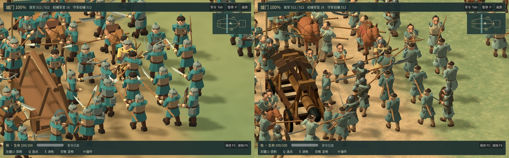
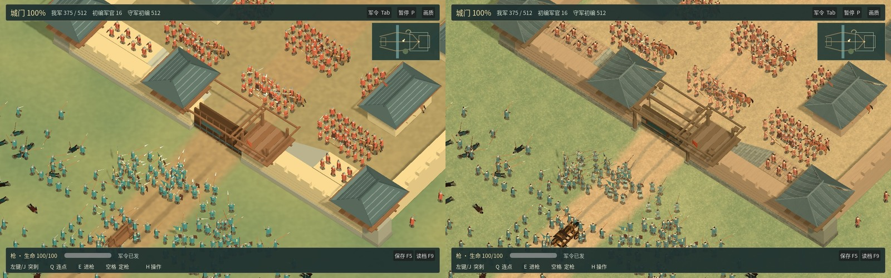

# 河关战役 0.16.0-rc.3 实机验收

[下载 macOS 候选包](https://github.com/haohongfei2001-png/luanshi-game/actions/runs/43245656470/artifacts/13956928552) · [完整带声战役](playthrough.mp4) · [RC2 与 RC3 并列实战](before-after.mp4) · [九武器握持与攻击录像](nine-weapons.mp4) · [原始测量](measurements.json)

游戏源码为 [799e1e41a098bf534b63f699ea6f683e4707306f](https://github.com/haohongfei2001-png/luanshi-game/commit/799e1e41a098bf534b63f699ea6f683e4707306f)。解开 Actions 外层归档和其中的 `Luanshi-macOS.zip`，打开 `Luanshi - Border Skirmish.app`。通用 macOS 候选包使用临时签名，Apple 公证待办。内层安装包 SHA-256 为 `2e9acd5b4694c92aa0315ed4e08255f6f709a52971de5a2429a4d2dd279c8ce6`，大小 69.2 MiB。托管 Mac 的校验和实战使用该包。Actions 归档到期日为 2027-02-10 UTC。 [完整 CI](https://github.com/haohongfei2001-png/luanshi-game/actions/runs/43245656470) · [Linux 版本](https://github.com/haohongfei2001-png/luanshi-game/actions/runs/43245656470/artifacts/13956988528) · [中文操作说明](../../PLAYING_ZH.md)

## 正常视角下的角色和河关

正式战役装配五类衣装与九种武器。面部、耳眉、手指、交领衣襟、札甲与箭囊使用原创 glTF 网格。皮、布、木、铁与皮肤共用分区材质图集。每套武器的关节姿势以 16 骨骼图集批量播放，兵器和前后握点随实际战斗时序运动。原始姿势的一轮检查发现长刀手腕最大约 0.51 米的分离。调整双手可达范围、握距和旋转精度后，最终烘焙数据中九武器 9,216 次左右手腕检查的最坏接缝为 1.24 毫米。该值量的是绑定接缝。 [角色美术源与导入](../../../assets/river_gate/figures/SOURCE.md) · [弓弩队](bowline-pair.jpg) · [敌将](officer-pair.jpg) · [原始特写](soldier-portrait.jpg)

马匹保留眼睑、鼻孔、蹄、衔铁、鞍毯和镫，步态与车轮随实际行进距离变化。轻车有辕、轮毂、车轴和乘员站位。河岸、桥梁、土路、关门、门楼、营帐和粮车共用一致尺度。悬槌随游戏中实际撞门周期运动。此批新模型、材质与动作均由本项目创作。 [骑马](journey-vehicle-horse.jpg) · [战车](journey-vehicle-cart.jpg) · [冲车](siege-pair.jpg) · [桥岸](ford-pair.jpg) · [营寨](camp-pair.jpg) · [马具源](../../../assets/art/mounts/README.md) · [地景源](../../../assets/environment/README.md)

十二个镜头从实际游戏入口同种子 61112 运行。成对验收约束双方各 512 普通兵、32 军官、相同步数、机位、缩放、画内身份集合、血战命中、伤亡及门体状态。使用清晰档和阴影。另有连续八秒的正常速度接战对照，每帧推进两个真实 20 Hz 模拟步，10 FPS 编码。 [近处接敌](contact-pair.jpg) · [常用战场视角](formation-pair.jpg) · [远景阵线](ranks-pair.jpg) · [原图及逐机位记录](https://github.com/haohongfei2001-png/luanshi-game/actions/runs/43245656470/artifacts/13956339237)

## 完整游玩和兼容

正式入口完成部署、选弓、调整队形、实战、号角传令、占领内庭、战报、继续行军、读档及再次整军。录像 59.1 秒，1280×800，原始双声道。玩家命中 7 次，传达军令 1 次，普通兵阵亡 257 / 308，第 1030 步结算「夺取城内阵地」。行军 1 小时后读回同一军情。 [开战准备](journey-01-muster.jpg) · [破门](journey-05-breach.jpg) · [战报](journey-06-report.jpg) · [战后营地](journey-07-camp.jpg) · [完整战役及其他实录](https://github.com/haohongfei2001-png/luanshi-game/actions/runs/43245656470/artifacts/13957826935)

九类武器逐一从鼠标、Q、E 和空格触发。对应实战命中为 剑 3、刀 2、棍 3、枪 3、长刀 3、弓 5、弩 3、剑盾 3、双剑 5。骑马和战车均验证了上乘、转向、技能和下乘。双边军官的挑战、格挡、独立作战、负伤救离、俘获和指挥继任经过固定场景回归。护送、撤离、败亡及守城也沿既有入口复测。 [逐武器与车辆记录](measurements.json) · [窗口回归原始记录](https://github.com/haohongfei2001-png/luanshi-game/actions/runs/43245656470/artifacts/13958241660)

旧版原码写入存档再启动本版续演，逐字段与原版本后续结算对照。v3 从 161 到 235 步，v4 从 629 到 746 步。另外用 RC2 原始代码 `71889537` 写下破门的真实 512v512 战局，RC3 从 629 到 746 步，对照字段差异 0。 [RC2 存档实测](raw/rc2-resume.log) · [归档构建校验和跨版本重放](https://github.com/haohongfei2001-png/luanshi-game/actions/runs/43248586922)

## 帧时间和内存

| 托管 Linux 软件渲染，每方普通兵 | FPS | P50 ms | P95 ms | P99 ms | 进程 RSS MiB | 窗口内新增命中 |
|---:|---:|---:|---:|---:|---:|---:|
| 20 | 9.6 | 105.12 | 115.76 | 115.98 | 414.2 | 42 |
| 100 | 6.6 | 151.50 | 161.55 | 162.26 | 412.0 | 167 |
| 250 | 6.0 | 167.37 | 178.12 | 185.71 | 453.1 | 262 |
| 512 | 4.9 | 208.31 | 232.71 | 233.83 | 463.5 | 288 |

以上数据来自 llvmpipe (LLVM 20.1.2, 256 bits)，1280×800 窗口，比例 1，开启阴影，开战后等待实际接敌再移动镜头。逐帧样本在本目录 `raw/`。

| 托管 macOS，每方 512 普通兵 | 实际输出像素 | 3D 比例 | FPS | P50 ms | P95 ms | P99 ms | 峰值 RSS MiB |
|---|---:|---:|---:|---:|---:|---:|---:|
| compat-1 | 960×600 | 1 | 36.8 | 27.95 | 39.01 | 44.46 | 382.6 |
| default-metal-1 | 960×600 | 1 | 84.3 | 8.00 | 30.34 | 39.80 | 422.9 |
| default-metal-2 | 960×600 | 1 | 112.6 | 6.59 | 21.53 | 27.90 | 424.4 |
| balanced-metal | 960×600 | 0.85 | 67.5 | 8.55 | 34.50 | 71.45 | 423.7 |
| performance-metal | 960×600 | 0.70 | 121.7 | 5.90 | 21.02 | 27.99 | 427.2 |
| compat-2 | 960×600 | 1 | 27.8 | 33.98 | 63.44 | 77.92 | 380.9 |
| shipping-metal | 1024×640 | 1 | 128.2 | 6.02 | 17.59 | 29.13 | 424.5 |

硬件标识 `Apple M1 (Virtual)`。默认窗口清晰档 1.0、阴影开启，系统提供 1024×645 窗口，实际回读 1024×640，记录 24.0 秒、3078 帧与 1147 次命中。帧时间按真实墙钟测量。设备提供的 GPU 时间戳和模拟、绘制 CPU 分项见原始 JSON。不可用的 GPU 时间保留空值。RC2 记录旧 `ViewportTexture.get_size()` 曾对根窗口重复应用缩放。该批归档十张 PNG 的实际尺寸均为 960×600。比例 0.70 时 3D 内部估算为 672×420，原始帧时间沿用实测值。 [完整 Mac 数据](raw/renderer-comparison.json) · [RC2 图像头复核](https://github.com/haohongfei2001-png/luanshi-game/actions/runs/43227869023/job/131215690381)

固定种子 CPU 对照运行采用基线、候选、候选、基线顺序。四档从同一军籍出发，定期存档快照及结算一致。512v512 的模拟步 P95 从 26.725 到 20.753 ms，P99 从 29.391 到 22.464 ms。 [逐逻辑步原始数据](https://github.com/haohongfei2001-png/luanshi-game/actions/runs/43220465442/artifacts/13945387029)

在早期美术候选与改进版的同 GPU 分离绘制实验中，密集近战提交 2,067,326 → 780,698 个三角面，P95 415.2 → 265.6 ms。快速横移的同期 P95 为 139.4 → 150.2 ms，仍是单独的长尾问题。该实验在 llvmpipe 上隔离绘制，不用于判定 Apple 硬件帧率。 [同 GPU 实验](https://github.com/haohongfei2001-png/luanshi-game/actions/runs/43231943100)

## 冷启动与保留问题

六次兼容/Metal 档位冷启动、一次显式失焦恢复、一次默认窗口巡场，共八个新进程和独立新游戏数据目录。保留系统驱动缓存。首次回读、获得焦点、部署、推进和首次命中有独立时间戳。RC2 曾在有画面且未推进时失败。真实失焦可稳定复现暂停，旧日志欠缺焦点状态。候选测试先观察窗口就绪，只有应用已到前台才按部署。专门失焦用例验证玩家回到游戏后仍可自行选择继续。 [启动与失焦时间线](raw/focus-control-boot.json) · [全部原生窗口日志](https://github.com/haohongfei2001-png/luanshi-game/actions/runs/43245656470/artifacts/13958911429)

真实 MacBook Air M5 持续 60 FPS 验收为 **NOT_RUN**。门前多人遮挡兵刃仍可发生。自动调整俯角的 11 组同构图试验中，可见手/兵刃比例中位改善 0 个百分点，4 组变差，故保留玩家原镜头。成长主角在河关一局累计击败数十名普通兵仍缺完整实录。近期新增的分队兵力与装备归账、士气、战斗强迫性和追击验收按 §1P 单独续接。 [镜头实验的实图与读数](https://github.com/haohongfei2001-png/luanshi-game/blob/072ebed4f53bee02c990f9f948ec5f9bafbf25e3/docs/evidence/river-gate-camera-lab/READBACK.md)

在装有 Godot 4.6.3 的 Linux 图形环境可执行 `./tools/compare-river-art.sh`、`./tools/test-field-journey.sh` 和 `./tools/test-field-render.sh`。运行 `./tools/test.sh` 检查模拟和历史存档，`./tools/export.sh` 导出安装包。托管 Mac 使用 `python3 tools/rc3_native_probe.py package/Luanshi-macOS.zip package/unpacked mac-evidence`。 [工程 PR #31](https://github.com/haohongfei2001-png/luanshi-game/pull/31)
