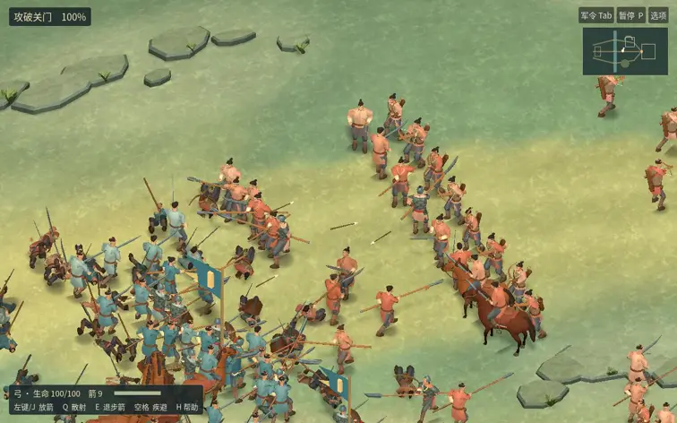

# 河关 0.16.0-rc.4 · 实机画面与可玩包

**美术状态为 ART_REVIEW_REQUIRED。** RC3 的人物美术已由 Owner 退回。这份候选把人物、动作、马匹和地形接入原战役。玩家的参考是《英雄联盟》实战镜头里清楚的轮廓、承重和挥击节奏。河关的兵器、衣甲、地图和声音均沿用本作设定。

[34 秒连续实战](battlefield-motion.mp4) · [同输入脚步对照](footwork-pair.mp4) · [从布阵到行军](playthrough.mp4) · [九种武器](nine-weapons.mp4) · [macOS 候选包](https://github.com/haohongfei2001-png/luanshi-game/actions/runs/43268026943/artifacts/13968240852)

## 镜头里能看到什么

- 对照左为 RC3，右为 RC4。在两版正式 Godot 场景重放同一批 512+512 名普通兵、32 名军官与主角。十二组截图的随机种子、模拟时刻、镜头中心、角度、缩放、画内单位、伤亡与城门状态一一对应。1280×800，内部缩放 1，阴影开启。 [主角](hero-pair.jpg) · [对阵](contact-pair.jpg) · [箭线](bowline-pair.jpg) · [军官](officer-pair.jpg) · [城门](gate-pair.jpg) · [坐骑](saddle-pair.jpg) · [战车](cart-pair.jpg) · [渡口](ford-pair.jpg) · [军营](camp-pair.jpg) · [远阵](formation-pair.jpg)
- 贴地的步伐、侧身移步、胯肩反向承重、抬手预备、击后收势都采样自正式输入与动画。第一次等输入回放发现起始镜头不同，最终镜头统一。持枪主角近身前走了 19.47 米，命中 1 次、承受 5 次打击后倒下。两版均记录到模拟第 80 步。 [连续动作分帧](motion-steps.jpg) · [两版数据](raw/after-motion.log)
- 弓手连续实录 1020 帧，主角命中 7 次，镜头随后沿交战线移向冲车。两军累计有效命中 1035 / 797 次，累计伤亡 200 / 233。此片按正常 30 帧时基录制，设备性能见实测表。 [原始日志](raw/battlefield-motion.log)

## 性能与启动

Godot 4.6.3。GitHub 托管 macOS 的 Apple M1 (Virtual)，mobile 清晰档，阴影开启，实际画幅 1024×640。双方各 512 名普通士兵的战役实际巡场 24.0 秒。

| 托管设备与普通兵/方 | 平均 FPS | P50 ms | P95 ms | P99 ms | 进程内存 MiB |
|---|---:|---:|---:|---:|---:|
| Apple M1 (Virtual) · 512 | 48.9 | 17.50 | 49.90 | 79.21 | 493 |
| Linux 软件渲染 · 20 | 6.56 | 150.92 | 160.47 | 163.76 | 460 |
| Linux 软件渲染 · 100 | 5.15 | 195.92 | 198.42 | 202.80 | 525 |
| Linux 软件渲染 · 250 | 4.50 | 223.37 | 232.25 | 233.56 | 535 |
| Linux 软件渲染 · 512 | 3.63 | 275.65 | 295.40 | 296.63 | 570 |

表中 macOS 为峰值 RSS，Linux 为各场景采样时的 RSS。不同宿主的结果分开读。真实 MacBook Air M5 为 **NOT_RUN**。实测采样含阵线接触、镜头平移、攻城、骑兵与投射物。软件绘制和虚拟显示器不代表玩家设备。[逐帧时间、画质与设备](measurements.json)

八次独立进程均以空游戏数据启动，覆盖兼容后端、Metal、焦点控制与默认窗口。系统图形驱动和 WindowServer 缓存按实际宿主状态保留。兼容后端第一次首帧 24.42 秒，第二次 3.97 秒。每次记录首帧、前台、部署、首次模拟和命中。 [原始时序和启动日志](raw/renderer-comparison.json)

## 战役与存档回归

- 实际输入覆盖剑、刀、棍、枪、长刀、弓、弩、剑盾、双剑，并覆盖骑乘、下马、战车、部署、号令、敌我军官、救援、继任、护送与战后结算。主流程经过 7 个可交互阶段，从营地读档并推进 1 小时。 [武器与载具](raw/field-controls.log) · [将领](raw/field-officers.log) · [军令与战报](raw/journey.log) · [护送](raw/field-escort-gui.log) · [胜负分支](raw/field-outcomes.log)
- 原始 RC3 写出的破门存档从第 629 步继续至第 746 步。逐字段差异数 0。历史 v3、v4 存档和游戏内驻营继续已分别复验。 [跨版复验](raw/rc3-resume.log) · [历史样本](raw/field-history.log)

## 源码、素材与复现

- 候选源码 [6e36e8f69526f2caf25501da5a777f63484f3162](https://github.com/haohongfei2001-png/luanshi-game/commit/6e36e8f69526f2caf25501da5a777f63484f3162)，CI 实际导出的合并树提交 [b0f44c491fb47634539e73571cabf2c73519575b](https://github.com/haohongfei2001-png/luanshi-game/commit/b0f44c491fb47634539e73571cabf2c73519575b)。[游戏 PR #34](https://github.com/haohongfei2001-png/luanshi-game/pull/34) · [CI 与产物](https://github.com/haohongfei2001-png/luanshi-game/actions/runs/43268026943) · [RC3 可回退源码](https://github.com/haohongfei2001-png/luanshi-game/commit/799e1e41a098bf534b63f699ea6f683e4707306f)
- macOS ZIP 内含可运行的 .app、中文指南及第三方许可。SHA-256 为 `691b1d77a3460e553b8002ad583d303c52b34af242248493d056534fade017c9`。这个散列校验解开 Actions 外层归档后的 Luanshi-macOS.zip。
- 脸部基础网格与形态来自 MakeHuman 的 CC0 数据，衣甲、马具、器械、动作与场景由本项目制作。资产与再分发记录见 [人物与动作](https://github.com/haohongfei2001-png/luanshi-game/blob/6e36e8f69526f2caf25501da5a777f63484f3162/assets/river_gate/figures/SOURCE.md)、[马匹](https://github.com/haohongfei2001-png/luanshi-game/blob/6e36e8f69526f2caf25501da5a777f63484f3162/assets/art/mounts/README.md)、[环境](https://github.com/haohongfei2001-png/luanshi-game/blob/6e36e8f69526f2caf25501da5a777f63484f3162/assets/environment/README.md)。
- 在有 Godot 4.6.3、Xvfb、FFmpeg 和 Python/Pillow 的云端环境签出候选源码，运行 `./tools/compare-river-art.sh` 复拍十二组镜头与正常速度实战。性能与输入流程可重跑 `./tools/test-field-journey.sh` 和 `./tools/test-field-render.sh`。原生启动复验使用 CI macos-runtime 作业。
